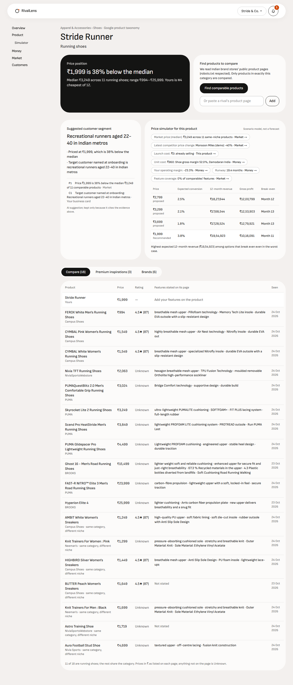
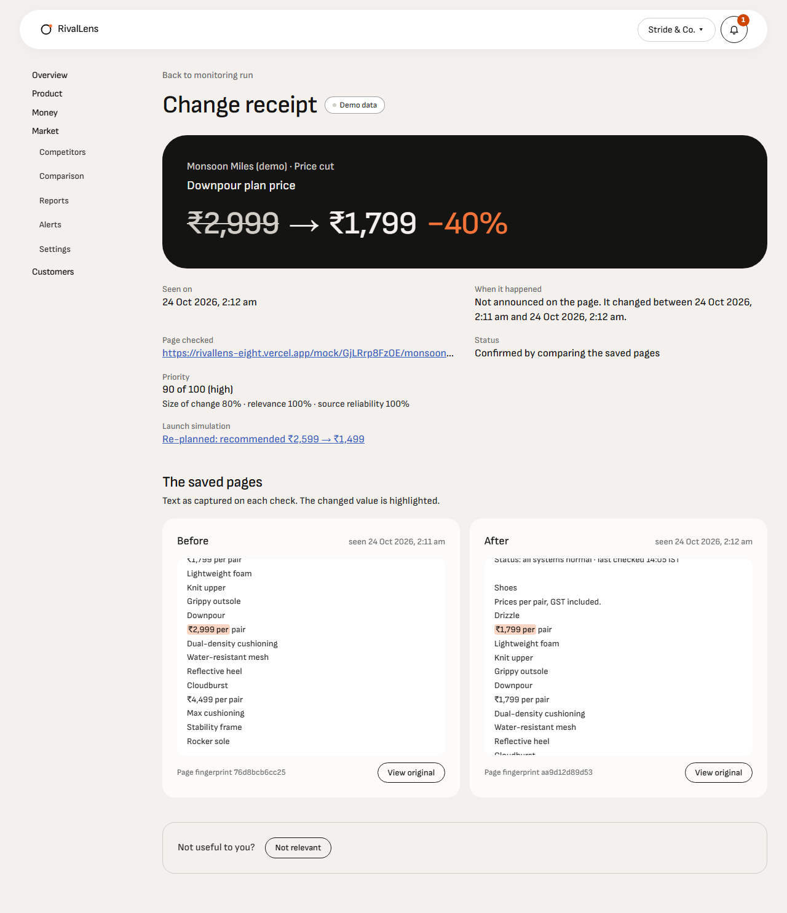
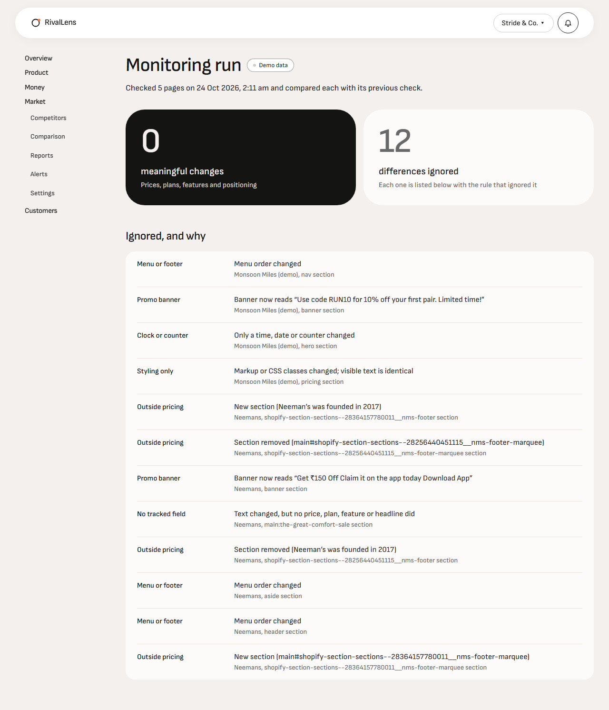
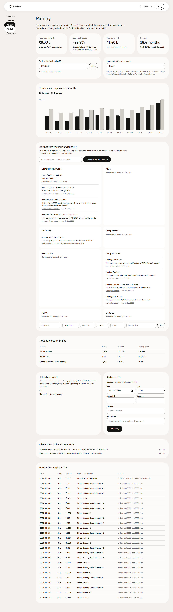

# RivalLens

**Competitor intelligence for Indian businesses that ignores redesign noise and keeps a dated receipt for every real change.**

Built solo for HackNova'26 (Pulzion). RivalLens is a working name.

| | |
|---|---|
| Live app | https://rivallens-eight.vercel.app (click a demo business on the login page, no sign-up) |
| API | https://rivallens-api.onrender.com/healthz |
| Architecture | [`hacknova26-competitor-intel-architecture.md`](hacknova26-competitor-intel-architecture.md) · [interactive diagram](hacknova26-competitor-intel-architecture.html) |
| Every decision and why | [`LEARNINGS-AND-DECISIONS.md`](LEARNINGS-AND-DECISIONS.md) |

## The problem

Small Indian businesses make pricing and product calls blind. Page-change tools alert on every redesign, one-off "competitor analysis" reports have no memory, and a founder's own numbers (sales, costs, reviews) sit in exports nobody connects to the market.

RivalLens puts four dashboards side by side and connects them:
- **Product:** every product in one exact Google product category, compared only with real products in that category (price position against the median, premium inspirations, each brand's range), with a suggested customer segment and a price simulator per product.
- **Finance:** revenue, margin, burn and runway from the business's own CSV or Excel exports, against Damodaran's India margins, plus competitors' revenue and funding quoted word for word from filings and news.
- **Market:** competitors' pricing pages watched over time. Real changes (a price cut, a dropped plan, a new feature, new positioning) get a **receipt**; redesign noise is listed with the rule that ignored it. Category prices now, and Indian market news.
- **Customers:** reviews, comments and insight exports turned into sentiment and themes (requests, complaints, praise), each opening the quotes it comes from.

The simulator on each product takes its inputs from the other three: the category median and the latest competitor receipt (Market), unit cost and runway (Finance), and sentiment and requests (Customers). Every input links to its dashboard.

## Golden path (about three minutes)

1. Open the live app and click **Stride & Co.** on the login page (a fictional running-shoe brand, *Demo business, modelled on Campus Activewear's FY26 margins and the UCI Online Retail II order pattern*).
2. **Overview:** 3 products, 19.4 months of runway, ₹6.00 L revenue a month, margin −23.3% against 8.3% for shoe companies in India, 5 competitors watched.
3. **Product → Stride Runner:** running shoes only. ₹1,999 sits below the median of real running shoes read from Puma, Brooks, Campus, Nivia and Neemans product pages; premium inspirations and brand ranges. The **segment** card cites the price position and the onboarding answers; the **simulator** shows its inputs as chips.
4. **Finance:** runway, margin against the benchmark, and Campus Activewear's reported revenue and profit, each with its quote and link.
5. **Customers:** Stride has no reviews (no licensed shoe-review dataset exists), so it says so; the bakery in step 9 has 60 real reviews analysed.
6. **Market → Simulate a competitor move:** *Redesign only* → **Check competitors now** → **0 meaningful changes**, every ignored difference listed with its rule. Then *Cut a price 40%* → **Check competitors now** → **1 meaningful change**: Monsoon Miles (demo) Downpour ₹2,999 → ₹1,799 (−40%). **See receipt:** saved pages before and after, the price highlighted, the date seen.
7. **Back to Product → Stride Runner:** the simulator now lists *Latest competitor price change: Monsoon Miles (demo) −40%* among its inputs, next to runway and unit cost from Finance.
8. **Reports → Generate report → Download PDF:** every claim links to its receipt with a date; AI text is labelled.
9. Log out and open **Kesar Bakehouse**: The Bread Basket's real transactions priced from Theobroma's menu, 60 reviews with themes, brownies compared with real brownies.

`node scripts/e2e/golden-path-v2.cjs <playwright-core> <out-dir> <chrome>` walks these steps on the live URL.

| Product: price position, segment and simulator | Market: a real change and its receipt |
|---|---|
|  |  |
| **Noise ignored, each with its rule** | **Finance against the India benchmark** |
|  |  |

## A new business, without help (Getting started)

Create an account, describe the business, and **Finish** lands on **Getting started**: one plan computed from what has been collected so far.
- Steps with their status: target market, product prices, competitors (discovered and verified for India, or the reasons none passed), like-for-like products, the first check of competitors' pricing pages. Finance and Customers uploads are optional.
- **Your next step:** exactly one, done in place (enter a price, find competitors, find products like yours, start watching).
- **What we found:** only what the data supports, each with its evidence: a price position needs at least 3 like-for-like prices; a gap of more than 60% from the median is flagged as a likely size or pack mismatch, not a conclusion.
- **Data coverage:** what is covered, missing or failed for Market, Products, Finance and Customers.

The overview shows the same next step, the top findings, what changed **since your last visit** and a status on each dashboard (Covered, Missing, Check failed, Out of date). Everything is read from saved data, so it survives refresh, logout and login. `BIZ="name|kind|city|what you do|products|customers|prices" node scripts/e2e/first-insight.cjs <playwright-core> <out-dir> <chrome>` walks it on the live URL as a brand-new founder (a coffee roaster by default).

### What counts as evidence
- A market median needs **at least 3 like-for-like prices**: every word that names the product type must match ("protein coffee powder" is not "filter coffee powder"). Similar products come from Indian stores' public catalogues (Shopify `/products.json`) and each page's own product data.
- Prices at ₹0, in another currency, or more than 5× from the others' median stay listed with the reason but don't count.
- Every number says whether it was **Observed** on a public page, is **Your data**, or is an **Estimate**.
- Competitor checks older than 14 days make re-checking the next step; prices older than 30 days are flagged, older than 90 days give no conclusion. Failed, running or stale searches are shown, never dropped.

### Deciding a price
The simulator on each product follows unit cost → gross profit → cash → runway. An existing product is calibrated to its real units sold in Finance, and each price shows the runway it leads to (at today's price this equals Finance's runway). A new product gets a month-by-month cash path. Every assumption shows where it came from and can be changed for that product; a sensitivity check says whether the best price changes if price sensitivity, unit cost or conversion is 20% off; saved scenarios are dated and say what changed since the last one.

## How change detection works

Detection is rules-first, so the core demo never depends on an LLM.

1. **Collect.** Fetch the page with robots.txt respected, 1 request per second per host, an SSRF guard on every redirect hop, a 3 MB cap and HTML only. The raw HTML is gzipped into private storage, which makes it the evidence.
2. **Split into sections.** Landmarks (`nav`, `header`, `footer`, `aside`) become sections, as do promo banners and each block inside `main`. Each section is hashed three ways: normalised text, raw text and HTML.
3. **Extract fields.** Pricing sections only: plan name, price (₹, Rs., INR, $ and USD, with a plausibility check), period and features, plus the `h1` headline. Numbers in sentences about credits, revenue, customers, spend or millions are dropped; this rule came from the real fixture pages.
4. **Classify every changed section.** Each one is either noise or field changes.

| Noise rule | Ledger reason |
|---|---|
| Change inside nav, header, footer or aside | `navigation_or_footer` |
| Element whose class or id is banner, promo, announcement or cookie | `promo_banner` |
| HTML changed, visible text identical | `formatting_only` |
| Only spacing or capitalisation changed | `whitespace` |
| Same lines in a new order | `reordering` |
| Only digits changed outside pricing (clocks, counters) | `dynamic_content` |
| Text changed outside pricing and headline | `outside_pricing` |

**Meaningful changes:**
- `price_increase` / `price_decrease` (with Δ%)
- `plan_added` / `plan_removed`
- `feature_added` / `feature_removed`
- `positioning_change` (headline token similarity below 0.8)

**Suspicious changes** are kept as *needs review* and never alert: a move of more than 80%, a price that disappears, or a currency switch.

**Priority** = `round(100 × (0.5·magnitude + 0.35·relevance + 0.15·source reliability))`. Relevance gets a bonus when a comparable competitor's price crosses below your planned price. Alerts are deduplicated by fingerprint, so a repeat shows "seen again" instead of a new alert.

## Evidence model

- A **receipt** = the change, its before and after snapshot ids, character offsets of the excerpt in each snapshot's text, the observed date and the previous check's date.
- `published_at` is only set when the page itself is dated. Otherwise the receipt says *"changed between X and Y"*.
- Snapshots are immutable. Scraped HTML is **never rendered in the app**: "View original" downloads the gzipped snapshot through a 5-minute signed URL and shows it in an `<iframe sandbox="">`.
- Reports contain only claims with an evidence id. Everything else goes to *Data limitations*. The LLM summary may only cite claim ids.

## Demo businesses (sign-ins)

Four fictional businesses, each its own account. The login page has a button for each, or sign in with the email and the shared password **`RivalLens-demo-2026`**. They're shared with other visitors, so anything you change is visible to the next person; `cd api && .venv/Scripts/python -m scripts.build_demo` rebuilds them.

| Sign-in | Business | Built from |
|---|---|---|
| `stride@rivallens.demo` | **Stride & Co.**, running shoes D2C, Pune | UCI Online Retail II order rhythm (CC BY 4.0) and Campus Activewear's FY26 margins; real Nivia, Neemans and Campus pages; brand product pages for comparison |
| `bakery@rivallens.demo` | **Kesar Bakehouse**, bakery café, Pune | The Bread Basket transactions (CC0) priced from Theobroma's public menu; Amazon Fine Food reviews (CC0) |
| `stacknest@rivallens.demo` | **StackNest**, app hosting SaaS, Pune | Real E2E Networks, Render and Railway pricing pages |
| `quickkart@rivallens.demo` | **QuickKart**, quick commerce, Bengaluru | Eternal (Blinkit) and Swiggy (Instamart) figures from filings and news |

**Nothing intelligent is hand-written (D-75).** `api/scripts/build_demo.py` signs in as each business and calls the same API endpoints the browser does: onboarding, products, uploads, competitors, comparables, competitor money and news. Every number on the dashboards is either from those files or from a public page with its link and date; anything else shows as *Unknown*. Sources and licences: [`fixtures/demo/ATTRIBUTION.md`](fixtures/demo/ATTRIBUTION.md).

## Demo data, labelled

- **Fictional companies:** NimbusDeploy, KiteHost, Orbitly Cloud, ZephyrPace and Monsoon Miles. All carry the *(demo)* suffix, and every mock page shows a *"Demo data: fictional company"* ribbon. Each demo business shows *"Demo business, modelled on …"* on its overview.
- **Fictional competitor pages** are served by this app at `/mock/{instance}/{slug}`; "Simulate a competitor move" on Market changes them.
- **Real companies** (Render, Railway, E2E Networks) appear only with values read from pages saved on 23 Oct 2026 (`fixtures/pricing-pages/`), dated with that capture time. Prices are never invented for a real company; where a page states none, the cell says *Unknown*.
- **Discovery** of real competitors (e.g. ESDS, Yotta, Tata Communications, E2E Networks, CtrlS for a Pune deployment startup) is live. Each candidate shows its India signals and why it passed or failed.

## Architecture

| Layer | Choice |
|---|---|
| Web | Next.js 16 (App Router) + Tailwind on Vercel |
| API | FastAPI + SQLAlchemy 2 + psycopg 3 on Render Free (Singapore) |
| Data | Supabase: Postgres via session pooler, Auth (email + anonymous guests), private Storage bucket `snapshots` |
| AI | Gemini `gemini-flash-lite-latest` → Groq `openai/gpt-oss-120b` fallback, every answer cached in Postgres. Used for card drafting, discovery candidates, classification and the report summary, **never for detection** |
| Search | Tavily (basic) for discovery |
| Email | Resend (to the owner's address only, no domain) |
| Keep-warm | GitHub Actions pings `/healthz` every 10 minutes (Render Free sleeps after 15) |

The API is a modular monolith: `collector`, `extractor`, `changes`, `alerts`, `discovery`, `comparison`, `simulator`, `reports`, `demo`, `profiles`. Jobs are a `jobs` table plus FastAPI background tasks, with stale detection on restart.

**Launch simulator (deterministic, specs §4.4).**
- The market price M is the median mid-tier ₹/month price across comparable competitors.
- Options are A = 0.85·M, B = M, C = 1.15·M, plus your planned price.
- Conversion is `c0·(p/M)^−e·(1 + k·(f − 0.5))`, with a ramp, 12-month revenue and break-even within 36 months.
- It recommends the highest expected revenue among options that break even even in the worst case.
- Viability flags (no India-verified competitors, crowded segment, no break-even, capital-intensive, incumbent-heavy) cite their evidence and assumptions.
- It is labelled *"Scenario model, not a forecast"*.

## Free-tier limits and how they're handled

| Provider | Limit we design for | Handling |
|---|---|---|
| Gemini free | low requests per minute; flash-latest timed out on this account | flash-lite default, 30 s timeout, Groq fallback, Postgres cache (repeat drafts are cache hits); empty answers are never cached |
| Groq free | Llama 3.3 retired (404) | `openai/gpt-oss-120b`; models checked by listing them with the key |
| Tavily | 1,000 credits/month | 3 basic searches per discovery; 5 discoveries per account a day; past 10 a day, discovery runs on AI suggestions only (each still verified) |
| Render Free | sleeps after 15 min idle, 512 MB | keep-warm pinger; reads retry twice while it wakes; no headless browser; pure-Python similarity instead of scikit-learn |
| Resend | delivers only to the account owner without a domain | `ALERT_EMAIL_OVERRIDE`; status recorded as sent, failed or skipped |
| Supabase email | built-in sender reaches only the project team | password reset emails need a free SMTP sender set in Supabase Auth (owner step); signed-in users can change their password without email |

## Run it locally

```bash
# API (Python 3.12+)
cd api && python -m venv .venv && .venv/Scripts/pip install -r requirements.txt -r requirements-dev.txt
# api/.env: DATABASE_URL (Supabase session pooler), SUPABASE_URL, SUPABASE_SERVICE_ROLE_KEY, SUPABASE_ANON_KEY,
#           GEMINI_API_KEY, GROQ_API_KEY, TAVILY_API_KEY, RESEND_API_KEY, ALERT_EMAIL_OVERRIDE, WEB_ORIGIN
.venv/Scripts/python -m scripts.setup_db --migrate --seed   # needs MOCK_BASE_URL pointing at a deployed web app
.venv/Scripts/uvicorn app.main:app --reload
.venv/Scripts/python -m pytest -q                            # 91 tests, no live LLM keys needed (recorded fixtures)

# Web
cd web && npm install && npm run dev   # NEXT_PUBLIC_API_BASE_URL, NEXT_PUBLIC_SUPABASE_URL, NEXT_PUBLIC_SUPABASE_PUBLISHABLE_KEY

# Smoke test the deployed app
FRONTEND_URL=https://rivallens-eight.vercel.app BACKEND_URL=https://rivallens-api.onrender.com bash scripts/smoke.sh

# Before and after a deploy: tests, smoke, account isolation, live overview and simulator checks (--full adds a new-founder walk)
PW=<playwright-core dir> CHROME=<chrome.exe> ISO_EMAIL=<test user> ISO_PASSWORD=<…> bash scripts/check-all.sh
```

**Account isolation:** `python -m scripts.isolation_check <user A> <password>` calls every API route (from the OpenAPI schema) without a token and as a fresh user B with A's ids; any 2xx for B is a leak. All 54 routes with ids pass.

**Scheduled checks:** `.github/workflows/scheduled-checks.yml` calls `POST /api/v1/cron/checks` daily. It starts only checks that are due (a week since the last, a day if pages failed), at most 3 a call, so it needs no secret.

Tests cover:
- the section splitter, price rules on real fixture lines, and the noise rules (cosmetic redesign → 0 changes) and field diff on rendered mock pages
- the priority score
- the LLM gateway (cache, fallback, repair, replay)
- India signals, the domain blocklist and similarity on real fixtures
- the comparison score (unknowns never count against anyone)
- the simulator formula against hand-computed cases, and the per-product inputs (sentiment bounded ±20%, coverage, unit cost, runway flag, segment evidence check)
- money parsing, de-duplication of bank settlements, and Unknown margin, burn and runway when no costs are uploaded
- category matching (sub-categories count, siblings don't), price position and news filtering
- the setup plan: steps, coverage, findings only with enough like-for-like prices, stale and failed data, services without product pages
- like-for-like matching, catalogue product picking and price screening (₹0, other currencies, outliers)
- the decision model: gross-profit break-even, calibration to real sales, runway at each price, launch cash path, sensitivity and scenario differences

## What's not built (honest limits)

- **Pricing extraction is rules-only.** The LLM merge for pricing sections was cut. Rules work well on structured pages; on JavaScript-heavy real pages many cells stay *Unknown*.
- **Wayback backfill** (archive history) was cut.
- **Password reset emails need an SMTP sender.** Supabase's built-in email reaches only the project team; add a free SMTP sender in Supabase Auth settings for reset links to reach users.
- **Price sensitivity is a default (1.2).** No business here has enough price history to estimate it; the sensitivity check shows how much the best price depends on it.
- **Services don't fit the product taxonomy.** Google's taxonomy covers goods; a membership or SaaS plan gets "Software" or no category, so its simulator anchors on the monitored competitors or its own price, labelled.
- **Web mentions only work for real brands.** The demo businesses are fictional, so their Customers dashboards use uploads only.
- **Quick-commerce sites (Blinkit, Zepto, Instamart, BigBasket, JioMart) refuse automated fetches,** so QuickKart watches no pages; its Market and Finance come from news and filings.
- **Shared demo sign-ins.** Anyone can change a demo business; `python -m scripts.build_demo` rebuilds it.
- **Discovery quality varies with free models.** Every accepted competitor is verified (reachable, robots-allowed, India signals), and rejections are shown.

## Repository map

`api/` FastAPI service · `web/` Next.js app · `supabase/migrations/` schema · `fixtures/` real pricing pages, robots.txt files, Wayback CDX and recorded LLM answers · `docs/build-plan/` step-by-step build plan · `hacknova26-*.md` scope, user journeys, architecture and specs.
