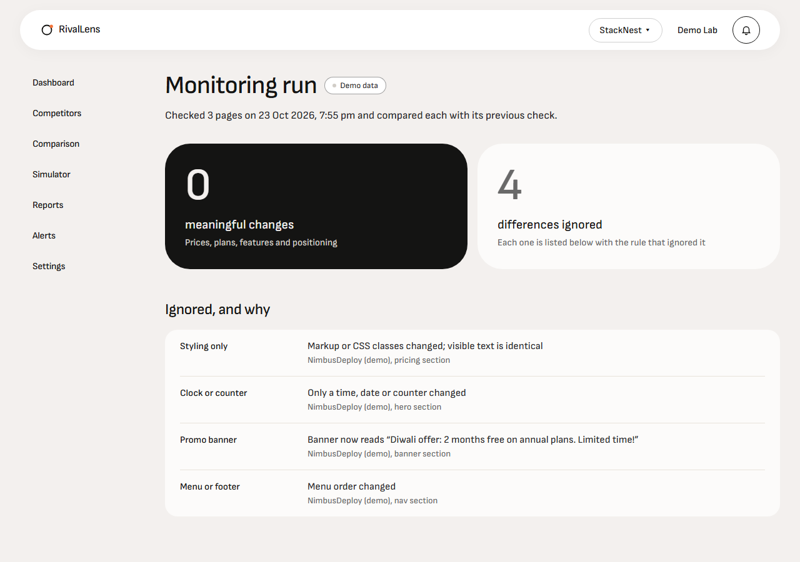
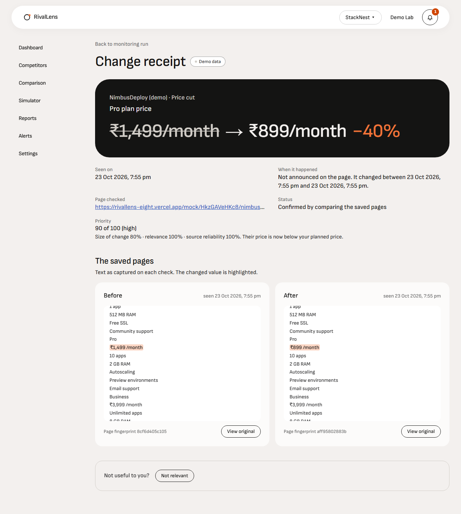
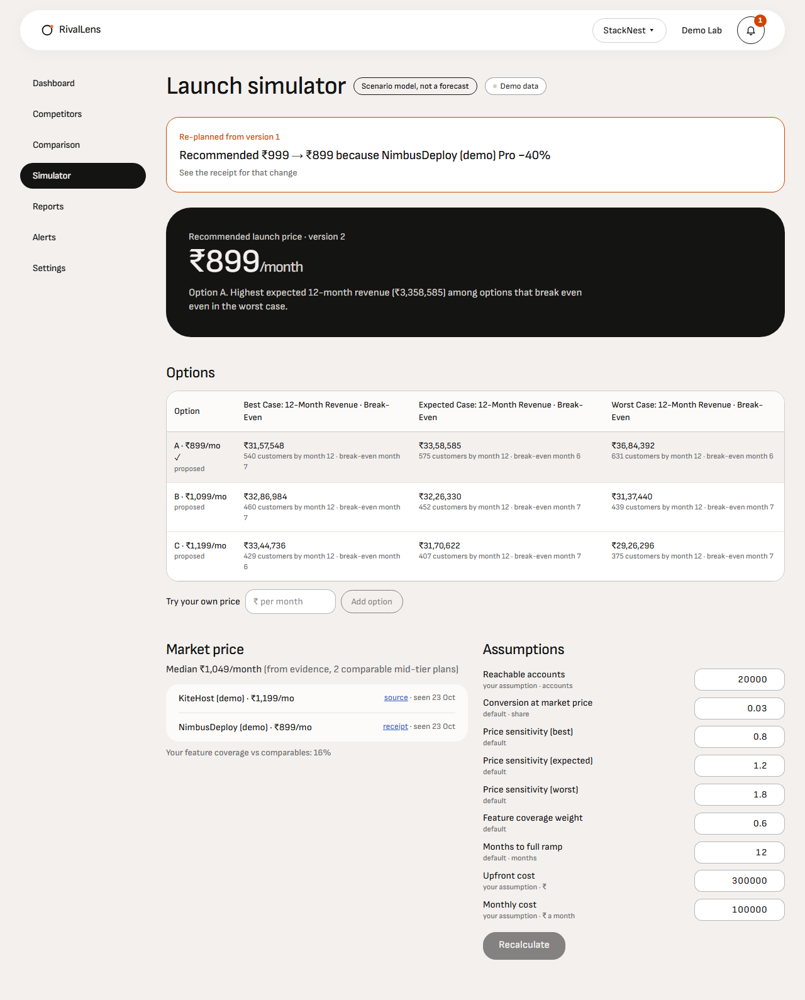
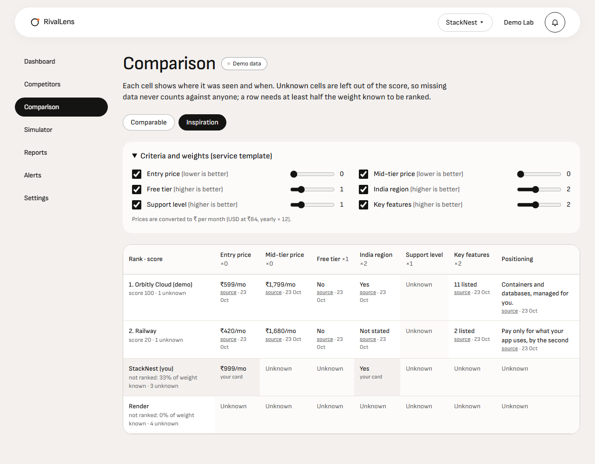

# RivalLens

**Competitor intelligence for Indian businesses that ignores redesign noise and keeps a dated receipt for every real change.**

Built solo for HackNova'26 (Pulzion). RivalLens is a working name.

| | |
|---|---|
| Live app | https://rivallens-eight.vercel.app (click **Try demo account**, no sign-up) |
| API | https://rivallens-api.onrender.com/healthz |
| Architecture | [`hacknova26-competitor-intel-architecture.md`](hacknova26-competitor-intel-architecture.md) · [interactive diagram](hacknova26-competitor-intel-architecture.html) |
| Every decision and why | [`LEARNINGS-AND-DECISIONS.md`](LEARNINGS-AND-DECISIONS.md) |

## The problem

Page-change tools alert on everything: a reordered menu, a new banner, a CSS tweak, a clock. Founders stop trusting them; false alerts are the most common complaint about such tools. A one-off "competitor analysis" report doesn't help either, because it has no memory and no proof.

RivalLens watches competitors' public pricing pages over time and separates **meaningful changes** (a price cut, a dropped plan, a new feature, new positioning) from **noise**. It **lists every ignored difference with the rule that ignored it**, and backs every claim with a **receipt**: the saved page before and after, the highlighted value and the date it was seen.

## Two-minute demo (the golden path)

1. Open the live app and click **Try demo account**. You get your own copy of four demo profiles, all labelled *Demo data*.
2. **Demo Lab:** click **Reset all pages**, then **Cosmetic-only redesign** on NimbusDeploy (demo). This changes the menu order, banner text, CSS classes and a clock. Use **View mock page** to see it.
3. **Open StackNest dashboard → Run monitor.** The run page shows **0 meaningful changes, 4 differences ignored**: menu or footer, promo banner, styling only, and clock or counter, each with a reason.
4. Back in Demo Lab, click **Cut Pro price 40% → Run monitor.** Result: **1 meaningful change**, NimbusDeploy (demo) Pro ₹1,499/month → ₹899/month (−40%).
5. **See receipt.** The before and after text has the price highlighted, plus page fingerprints, the date seen, and "it changed between X and Y". **View original** opens the saved page in a sandboxed frame where no scripts run.
6. The **bell** shows a High alert (priority 90, "now below your planned ₹999"), and the owner inbox gets an email copy.
7. The **Simulator** has re-planned: *"Recommended ₹999 → ₹899 because NimbusDeploy (demo) Pro −40%"*. It shows best/expected/worst cases for each option, with every assumption labelled.
8. **Reports → Generate → Download PDF.** Every claim links to its receipt with a date, AI suggestions are labelled, and data limitations are listed.

Other screens to explore:
- **Comparison:** a weighted matrix where unknown cells are never scored.
- **Competitors:** automated discovery of India-serving competitors; rejected candidates show why.
- **Competitor detail:** price history and timeline.
- **Qubit Labs:** an idea profile whose viability flags fire.

| Noise ignored (0 meaningful, 4 ignored) | The receipt for a real price cut |
|---|---|
|  |  |
| **Simulator re-planned by that receipt** | **Sourced comparison, Unknown never scored** |
|  |  |

## How change detection works

Detection is rules-first, so the core demo never depends on an LLM.

1. **Collect.** Fetch the page with robots.txt respected, 1 request per second per host, an SSRF guard on every redirect hop, a 3 MB cap and HTML only. The raw HTML is gzipped into private storage, which makes it the evidence.
2. **Split into sections.** Landmarks (`nav`, `header`, `footer`, `aside`) become sections, as do promo banners and each block inside `main`. Each section is hashed three ways: normalised text, raw text and HTML.
3. **Extract fields.** Pricing sections only: plan name, price (₹, Rs., INR, $ and USD, with a plausibility check), period and features, plus the `h1` headline. Numbers in sentences about credits, revenue, customers, spend or millions are dropped; this rule came from the real fixture pages.
4. **Classify every changed section.** Each one is either noise or field changes.

| Noise rule | Ledger reason |
|---|---|
| Change inside nav, header, footer or aside | `navigation_or_footer` |
| Element whose class or id is banner, promo, announcement or cookie | `promo_banner` |
| HTML changed, visible text identical | `formatting_only` |
| Only spacing or capitalisation changed | `whitespace` |
| Same lines in a new order | `reordering` |
| Only digits changed outside pricing (clocks, counters) | `dynamic_content` |
| Text changed outside pricing and headline | `outside_pricing` |

**Meaningful changes:**
- `price_increase` / `price_decrease` (with Δ%)
- `plan_added` / `plan_removed`
- `feature_added` / `feature_removed`
- `positioning_change` (headline token similarity below 0.8)

**Suspicious changes** are kept as *needs review* and never alert: a move of more than 80%, a price that disappears, or a currency switch.

**Priority** = `round(100 × (0.5·magnitude + 0.35·relevance + 0.15·source reliability))`. Relevance gets a bonus when a comparable competitor's price crosses below your planned price. Alerts are deduplicated by fingerprint, so a repeat shows "seen again" instead of a new alert.

## Evidence model

- A **receipt** = the change, its before and after snapshot ids, character offsets of the excerpt in each snapshot's text, the observed date and the previous check's date.
- `published_at` is only set when the page itself is dated. Otherwise the receipt says *"changed between X and Y"*.
- Snapshots are immutable. Scraped HTML is **never rendered in the app**: "View original" downloads the gzipped snapshot through a 5-minute signed URL and shows it in an `<iframe sandbox="">`.
- Reports contain only claims with an evidence id. Everything else goes to *Data limitations*. The LLM summary may only cite claim ids.

## Demo data, labelled

- **Fictional companies:** NimbusDeploy, KiteHost, Orbitly Cloud, ZipBasket, DashMart, Minute Pantry, PaceRun, Trailhawk, Urban Sole, QCloud Access and Qubitly. All carry the *(demo)* suffix, and every mock page shows a *"Demo data: fictional company"* ribbon.
- **Demo Lab mock pages** are served by this app at `/mock/{instance}/{slug}`. Each guest gets private instances, so judges never collide.
- **Real companies** (Render, Railway, E2E Networks) appear only with values read from pages saved on 23 Oct 2026 (`fixtures/pricing-pages/`), dated with that capture time. Prices are never invented for a real company; where a page states none, the cell says *Unknown*.
- **Discovery** of real competitors (e.g. ESDS, Yotta, Tata Communications, E2E Networks, CtrlS for a Pune deployment startup) is live. Each candidate shows its India signals and why it passed or failed.

## Architecture

| Layer | Choice |
|---|---|
| Web | Next.js 16 (App Router) + Tailwind on Vercel |
| API | FastAPI + SQLAlchemy 2 + psycopg 3 on Render Free (Singapore) |
| Data | Supabase: Postgres via session pooler, Auth (email + anonymous guests), private Storage bucket `snapshots` |
| AI | Gemini `gemini-flash-lite-latest` → Groq `openai/gpt-oss-120b` fallback, every answer cached in Postgres. Used for card drafting, discovery candidates, classification and the report summary, **never for detection** |
| Search | Tavily (basic) for discovery |
| Email | Resend (to the owner's address only, no domain) |
| Keep-warm | GitHub Actions pings `/healthz` every 10 minutes (Render Free sleeps after 15) |

The API is a modular monolith: `collector`, `extractor`, `changes`, `alerts`, `discovery`, `comparison`, `simulator`, `reports`, `demo`, `profiles`. Jobs are a `jobs` table plus FastAPI background tasks, with stale detection on restart.

**Launch simulator (deterministic, specs §4.4).**
- The market price M is the median mid-tier ₹/month price across comparable competitors.
- Options are A = 0.85·M, B = M, C = 1.15·M, plus your planned price.
- Conversion is `c0·(p/M)^−e·(1 + k·(f − 0.5))`, with a ramp, 12-month revenue and break-even within 36 months.
- It recommends the highest expected revenue among options that break even even in the worst case.
- Viability flags (no India-verified competitors, crowded segment, no break-even, capital-intensive, incumbent-heavy) cite their evidence and assumptions.
- It is labelled *"Scenario model, not a forecast"*.

## Free-tier limits and how they're handled

| Provider | Limit we design for | Handling |
|---|---|---|
| Gemini free | low requests per minute; flash-latest timed out on this account | flash-lite default, 30 s timeout, Groq fallback, Postgres cache (repeat drafts are cache hits); empty answers are never cached |
| Groq free | Llama 3.3 retired (404) | `openai/gpt-oss-120b`; models checked by listing them with the key |
| Tavily | 1,000 credits/month | 3 basic searches per discovery; demo guests limited to 2 discoveries a day; global cap 20 a day |
| Render Free | sleeps after 15 min idle, 512 MB | keep-warm pinger; no headless browser; pure-Python similarity instead of scikit-learn |
| Resend | delivers only to the account owner without a domain | `ALERT_EMAIL_OVERRIDE`; status recorded as sent, failed or skipped |

## Run it locally

```bash
# API (Python 3.12+)
cd api && python -m venv .venv && .venv/Scripts/pip install -r requirements.txt -r requirements-dev.txt
# api/.env: DATABASE_URL (Supabase session pooler), SUPABASE_URL, SUPABASE_SERVICE_ROLE_KEY, SUPABASE_ANON_KEY,
#           GEMINI_API_KEY, GROQ_API_KEY, TAVILY_API_KEY, RESEND_API_KEY, ALERT_EMAIL_OVERRIDE, WEB_ORIGIN
.venv/Scripts/python -m scripts.setup_db --migrate --seed   # needs MOCK_BASE_URL pointing at a deployed web app
.venv/Scripts/uvicorn app.main:app --reload
.venv/Scripts/python -m pytest -q                            # 33 tests, no live LLM keys needed (recorded fixtures)

# Web
cd web && npm install && npm run dev   # NEXT_PUBLIC_API_BASE_URL, NEXT_PUBLIC_SUPABASE_URL, NEXT_PUBLIC_SUPABASE_PUBLISHABLE_KEY

# Smoke test the deployed app
FRONTEND_URL=https://rivallens-eight.vercel.app BACKEND_URL=https://rivallens-api.onrender.com bash scripts/smoke.sh
```

Tests cover:
- the section splitter, price rules on real fixture lines, and the noise rules (cosmetic redesign → 0 changes) and field diff on rendered mock pages
- the priority score
- the LLM gateway (cache, fallback, repair, replay)
- India signals, the domain blocklist and similarity on real fixtures
- the comparison score (unknowns never count against anyone)
- the simulator formula against hand-computed cases

## What's not built (honest limits)

- **Pricing extraction is rules-only.** The LLM merge for pricing sections was cut. Rules work well on structured pages; on JavaScript-heavy real pages many cells stay *Unknown*.
- **Wayback backfill** (archive history) was cut.
- **No scheduled monitoring yet.** Runs are on demand; the MVP adds a cron.
- **Discovery quality varies with free models.** Every accepted competitor is verified (reachable, robots-allowed, India signals), and rejections are shown.

## Repository map

`api/` FastAPI service · `web/` Next.js app · `supabase/migrations/` schema · `fixtures/` real pricing pages, robots.txt files, Wayback CDX and recorded LLM answers · `docs/build-plan/` step-by-step build plan · `hacknova26-*.md` scope, user journeys, architecture and specs.
