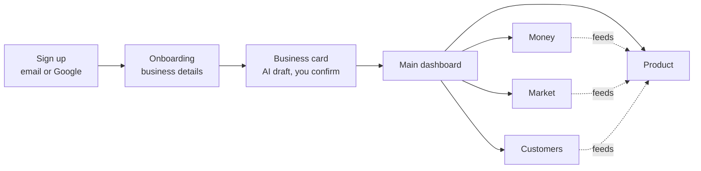
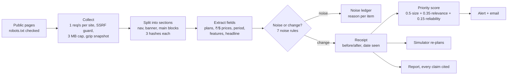
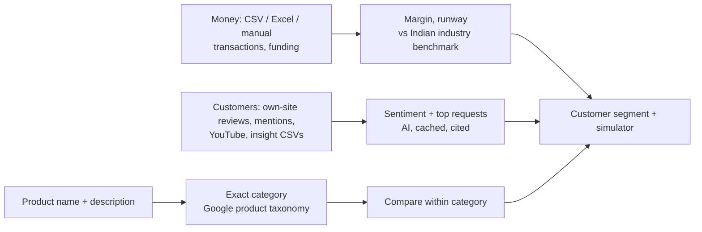
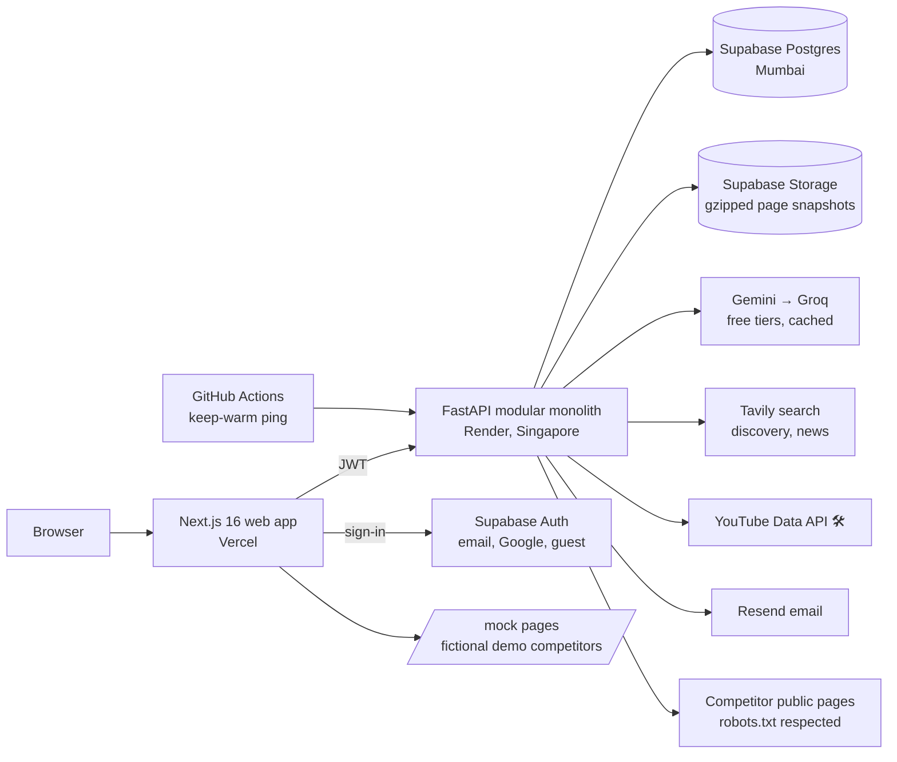

# HackNova'26 final-round deck: slide content

Content for the official 10-slide template (`HACKNOVA26_Final_Round_Presentation_Template.pptx`). Delete slide 11 (the instructions slide) before submitting.

Each slide below gives:
- the text to put on the slide
- the diagram, as Mermaid plus a layout note, so it can be redrawn in PowerPoint or Claude chat
- icon suggestions (names from the free [Lucide](https://lucide.dev) set)
- the screenshots to use
- speaker notes

**Labels used throughout:**
- **✅ Built**: works today on the live URL.
- **🛠 Planned**: being built tonight or later.

Every slide must keep these two apart (template rule 10).

Placeholders to fill in: `[PRODUCT NAME]` (RivalLens is a working name; a live product called "Rival Lens" already exists, L-07), `[PS TITLE]`, `[TEAM]`.

---

## Slide 1: Project and problem statement details

| Field | Value |
|---|---|
| Project / Solution Title | **[PRODUCT NAME]: evidence-backed business intelligence for Indian startups and small businesses** |
| Problem Statement Title | `[PS TITLE]` (official title: Competitor Intelligence & Market Monitoring Agent; confirm the exact wording) |
| GitHub Repository Link | https://github.com/Niranjan-cyber/rivallens (**make it public before submitting**) |
| Live Prototype / Demo Link | https://rivallens-eight.vercel.app (click **Try demo account**, no sign-up; demo business sign-ins are listed in the README once B14j ships) |
| Figma / Design Link | Delete the row (there's no Figma file; the design system is `web/DESIGN.md` in the repo) |
| Team Name / Leader / Members | `[TEAM]` |

Speaker notes: none, since this slide is read, not presented.

---

## Slide 2: Problem statement and existing challenges

**Headline:** Small businesses can't see their market clearly, and the tools that try to show it either cry wolf or can't prove what they say.

**Context, with real numbers:**
- **2.23 lakh** DPIIT-recognised startups in India as of 31 Mar 2026, with **55,200** added in FY26 alone ([Inc42](https://inc42.com/buzz/centre-recognises-record-55200-startups-in-fy26/)).
- **7.83 crore** enterprises registered on Udyam as of 28 Feb 2026 ([IBEF, citing the Ministry of MSME](https://www.ibef.org/news/over-7-83-crore-enterprises-registered-on-udyam-platforms-indicating-strong-msme-formalisation-growth)).

**Who is affected:** first-time founders, D2C sellers (for example a shoe brand), SaaS teams and local business owners. None of them has a market-research team.

**Existing challenges** (4 cards, one icon each):

| Icon | Challenge | Evidence |
|---|---|---|
| `eye-off` | **Competitor moves go unnoticed.** Nobody has time to check 8 or more competitors' pricing pages every week. | The problem statement asks for continuous monitoring with history |
| `bell-ring` | **Monitoring tools cry wolf.** A changed banner or reordered menu triggers an alert, so people stop trusting them. | False alerts are the top con for Visualping on G2 (30 mentions) ([G2](https://www.g2.com/products/visualping)) |
| `file-question` | **AI reports have no memory or proof.** A one-off "competitor analysis" can't say when a price changed or show the page it came from. | No source and no date means no way to check it |
| `puzzle` | **Business data is scattered.** Sales sit in Excel or payment exports, reviews on the website, social numbers in separate apps, and none of it reaches the pricing decision. | Enterprise tools (Crayon, Klue) are built and priced for large sales teams |

**Diagram:** none. Use the two stat callouts on top and the 4 challenge cards below.

**Speaker notes (20 s):** "India adds about 150 startups a day. Each of them launches into a market that someone else is already moving in. Today they either check competitor sites by hand or use a page-watcher that alerts on every banner change. Neither tells them what actually changed, or what to do about it."

---

## Slide 3: Proposed solution

**Headline:** One workspace that watches your market, proves every claim, and turns your money, market and customer data into product decisions.

**How a user moves through it:**

Layout note: a left-to-right flow. Draw the four dashboards as four tiles, with dotted arrows from Money, Market and Customers into Product, since Product is the main layer.

**The four dashboards** (4 tiles):

| Icon | Dashboard | What it shows | Status |
|---|---|---|---|
| `package` | **Product** (main layer) | Existing and new products, each in an exact market category (a football is compared only with footballs). Comparisons on price, revenue, features and add-ons. Premium-market inspirations. A suggested customer segment per product. A launch simulator. | ✅ simulator and comparison per business · 🛠 per-product, category matching, segments |
| `wallet` | **Money** | Revenue, funding, profit margin against the Indian industry benchmark, product prices, the transaction log (CSV/Excel upload or manual entry), and runway. | 🛠 |
| `trending-up` | **Market** | What direct competitors changed (price, plans, features, positioning), each with a dated receipt. Category news and funding. Category price trend. Competitor discovery in India. | ✅ monitoring, receipts, alerts, discovery, comparison, report · 🛠 news, price trend |
| `messages-square` | **Customers** | Reviews from your own site, web mentions, YouTube comments and uploaded insight exports, with sentiment and the top things customers ask for. | 🛠 |

**Real data, never made up** (one line under the tiles):
- Every number is either **entered or uploaded by the business** or **taken from a public source with a link and date**: competitor pages, company filings, news, the Google product taxonomy, Damodaran's India industry margins.
- Anything else shows as *Unknown*.
- Demo businesses are built by running the same pipeline on licensed datasets, and are labelled *Demo business, modelled on …*.

**What makes it different** (4 short points with icons):
- `list-filter` **Noise ledger:** it lists every ignored difference and the rule that ignored it. Nobody else shows this.
- `receipt` **Receipts:** every change keeps the saved page before and after, the highlighted value and the date seen.
- `git-compare` **Like-for-like comparison:** exact categories, and Unknown stays Unknown; it is never guessed or scored.
- `refresh-cw` **Decisions that update themselves:** a competitor's price cut automatically re-plans your recommended launch price, and links to the receipt that caused it.

**Speaker notes (40 s):** "The core is the monitoring loop the problem statement asks for: detect, prove, alert, report. We built that first and it works today. Around it, the company's own money and customer data feed one place: the product. That's where a founder decides what to sell, to whom, and at what price."

---

## Slide 4: Technical approach and system workflow

**Headline:** Rules decide what changed; AI only drafts and summarises.

**Workflow diagram** (main row = the monitoring loop, which is ✅ built):

Second row (🛠 planned), drawn as inputs into the Product layer:

**Key logic** (bullets beside the diagram):
- **Noise rules:**
  - nav/header/footer
  - promo banner
  - formatting only
  - whitespace
  - reordering
  - clocks and counters
  - text outside pricing
- **Meaningful changes:**
  - price up or down
  - plan added or removed
  - feature added or removed
  - headline change
- **Suspicious changes** (a move over 80%, a missing price, a currency switch) are kept for review and never alert.
- **Simulator:**
  - Market price M is the median comparable ₹/month price.
  - Options are 0.85M, M, 1.15M and your own price.
  - Conversion is `c0·(p/M)^−e`, with break-even checked within 36 months.
  - It picks the best expected revenue among the options that still break even in the worst case.
- **AI, free tier:**
  - Gemini first, Groq as fallback.
  - Every answer is cached in Postgres, and tests replay recorded answers.
  - It is never used to decide whether something changed.

Icons: `globe`, `scissors`, `table`, `filter`, `receipt`, `gauge`, `bell`, `calculator`, `file-text`.

**Speaker notes (40 s):** walk the top row left to right using the live example: "A cosmetic redesign gives 0 alerts and 4 ignored items. A 40% price cut gives 1 alert at priority 90, and the simulator moves from ₹999 to ₹899."

---

## Slide 5: System architecture

**Inside the API** (draw as a box of modules): collector · extractor · changes · alerts · discovery · comparison · simulator · reports · demo · profiles, plus 🛠 products · money · market-news · customers.

**Data flow, in 3 numbered callouts:**
1. The browser signs in with Supabase and sends its JWT to the API.
2. The API fetches public pages, stores each one as an unchangeable snapshot and writes observations and receipts to Postgres.
3. The web app reads only the API's JSON. Scraped HTML is never rendered in the app: "View original" opens in a sandboxed iframe through a 5-minute signed link.

Icons: `monitor`, `server`, `database`, `hard-drive`, `sparkles`, `search`, `mail`, `shield-check`.

**Speaker notes (25 s):** "One API, one database, all on free tiers. Jobs are a table plus background tasks, so a restart marks unfinished jobs as stale instead of losing them."

---

## Slide 6: Technology stack and implementation

| Layer | Technology | Why |
|---|---|---|
| Web | Next.js 16 (App Router), React, Tailwind v4, Vercel | Server components, Git auto-deploy, print-to-PDF reports |
| API | FastAPI, SQLAlchemy 2, psycopg 3, httpx, selectolax (lexbor) | Fast typed routes; a fast HTML parser that fits in 512 MB |
| Data | Supabase Postgres, Auth (email, Google, anonymous guests) and private Storage | One free provider for the database, sign-in and evidence files |
| AI | Gemini `flash-lite` → Groq `gpt-oss-120b` | Free, with fallback; answers cached and checked against a JSON schema |
| Search | Tavily (free 1,000 credits a month) | Competitor discovery, category news and funding |
| Email | Resend | Alert emails |
| Sign-in | Supabase Auth: verified email (sent through Gmail SMTP, free) and Google sign-in (🛠) | Real accounts at no cost |
| Datasets (🛠) | Google product taxonomy, Damodaran India margins, Flipkart products (CC BY-SA), UCI Online Retail II (CC BY), The Bread Basket (CC0) | Exact categories, margin benchmarks, category prices, demo businesses' transactions |

**Database design** (small ER strip): profiles → competitors → sources → snapshots → observations → change_events (receipts) → alerts; simulations (versioned); reports; plus 🛠 products, transactions, customer_mentions.

**Testing, security and deployment** (3 columns):

- **Testing**
  - 33 automated tests, run with recorded AI answers (`LLM_MODE=replay`), never live keys.
  - A smoke script runs against the live URLs.
  - The golden path is walked in a browser before every checkpoint.
- **Security**
  - robots.txt and rate limits.
  - An SSRF guard on every redirect.
  - Scraped HTML is never rendered in the app.
  - JWT is checked on every API call, and the service key never reaches the browser.
  - Guests are rate limited.
- **Deployment**
  - Git push auto-deploys Vercel and Render.
  - Database changes are versioned SQL migrations.
  - A keep-warm ping runs every 10 minutes.

Icons: `layers`, `test-tube`, `lock`, `rocket`.

---

## Slide 7: Prototype and key features

**Live link with a QR code:** https://rivallens-eight.vercel.app. Generate the QR from the link.

**Screenshots:** a 2×2 grid. All 4 are already in the repo at `docs/screenshots/`.

| Screenshot | Caption |
|---|---|
| `s10-noise-ledger.png` | Cosmetic redesign: **0 meaningful, 4 ignored**, each with a reason |
| `s11-receipt.png` | Receipt: Pro ₹1,499 → ₹899 (−40%), highlighted before/after, date seen |
| `s14-simulator-replanned.png` | Simulator re-planned: ₹999 → ₹899, linked to the receipt |
| `s13-comparison.png` | Comparison: every cell sourced and dated, Unknown never scored |

**Built vs planned** (two columns):

| ✅ Built and live | 🛠 Planned (in build) |
|---|---|
| Email sign-up, guest demo | Verified email + Google sign-in |
| Business card drafted by AI | Onboarding form → card → main dashboard |
| Change detection + noise ledger | Four dashboards: Product, Money, Market, Customers |
| Receipts with frozen evidence | Products in exact Google-taxonomy categories, compared like for like, with premium inspirations |
| Alerts (bell + email), alert rules | Money: CSV/Excel/manual transactions, margin vs Damodaran India benchmark, runway |
| Competitor discovery in India | Competitors' revenue and funding from filings and news, cited |
| Sourced comparison matrix | Customers: uploads, own-site reviews, web mentions → sentiment and top requests |
| Launch simulator that re-plans on a receipt | Customer segment per product; simulator fed by Money, Market and Customers |
| Evidence-linked report + PDF | "Simulate a competitor move" inside Market (replaces the Demo Lab page) |
| Competitor history timeline | Four demo businesses (footwear D2C, bakery, SaaS, quick commerce) built from real datasets |
| Simulated price/feature change (Demo Lab) | |

> If the deck can be resubmitted at 08:00, move the items finished overnight into the left column and replace one screenshot with the Product dashboard.

**Speaker notes (30 s):** "Everything on the left works now on the link. Scan the code and try the demo account. The right column is what we're building next."

---

## Slide 8: Feasibility, impact and benefits

**Technical feasibility:** runs today at **₹0 a month** on free tiers.

| Service | Free limit | How we stay within it |
|---|---|---|
| Gemini / Groq | Low requests per minute | Answers cached in Postgres; fallback model; empty answers never cached |
| Tavily | 1,000 credits a month | 3 searches per discovery; guests limited to 2 a day, 20 a day across the app |
| Render | Sleeps after 15 min, 512 MB | Keep-warm ping; no headless browser |
| Supabase | 500 MB database, 1 GB storage | Snapshots gzipped |

**Operational feasibility:** a founder signs up, fills one form and gets a usable dashboard. No integrations are needed, because files can be uploaded instead.

**Risks and mitigations** (3 rows):

| Risk | Mitigation |
|---|---|
| Sites block or change layout | robots.txt respected; failures shown as "Failed (not a change)"; Unknown, never guessed |
| AI is wrong | Rules decide changes; AI only drafts and summarises, and its suggestions must cite evidence |
| Data trust | Every number is cited or entered by the user; demo data always labelled |

**Measured results from our own runs** (real, not projected):
- A cosmetic redesign produced **0 false alerts** (4 differences ignored, each with its reason).
- A 40% price cut was detected in **1 run** and alerted at priority **90**, and the simulator re-planned automatically.
- Live discovery verified **5 Indian providers** (ESDS, Yotta, Tata Communications, E2E Networks, CtrlS) in **53 s**.
- 33 automated tests pass; the API health check answered in **0.34 s** when warm.

**Target users and benefits:** founders, D2C sellers, local shops and SaaS teams. They save the weekly manual checks, get fewer and truer alerts, have proof they can show investors, and make pricing decisions tied to evidence.

Icons: `indian-rupee`, `shield-alert`, `users`, `timer`.

---

## Slide 9: Extra slide, data sources and future scope

**Left half: the free, real data we use**

| Source | Used for | Licence or terms |
|---|---|---|
| Competitors' public pages | Prices, plans, features, history | robots.txt respected, 1 request/s |
| [Google product taxonomy](https://support.google.com/merchants/answer/6324436) (~5,500 categories) | Exact product category | Free to use |
| [Damodaran, margins by industry, India](https://pages.stern.nyu.edu/~adamodar/pc/datasets/marginIndia.xls) (NYU Stern, Jan 2026) | Margin benchmarks on Money | Public academic data, with credit |
| [Flipkart products, Kaggle](https://www.kaggle.com/datasets/PromptCloudHQ/flipkart-products/data) | Starting category price benchmarks (dated) | CC BY-SA 4.0 |
| [UCI Online Retail II](https://archive.ics.uci.edu/dataset/502/online+retail+ii) | Transaction pattern for the footwear demo business, and the sample upload file | CC BY 4.0 |
| [The Bread Basket](https://api.openml.org/d/43422) (20,507 real bakery sales) | Transactions for the bakery demo business | CC0 |
| Listed companies' results (e.g. [Campus Activewear FY26](https://apparelresources.com/business-news/retail/campus-activewear-q4-pat-rises-us-5-2-million-ebitda-fy-26-reaches-us-37-million/): ASP ₹683, gross margin 53.5%) | Competitor revenue and margins; unit economics for the footwear demo business | Public filings and press coverage, cited |
| Tavily search | Discovery, category news, funding (each with a link) | Free tier |
| YouTube Data API | Comments on the company's videos | Free quota |
| The company's own exports (bank, Razorpay, Shopify, Meta Business Suite, LinkedIn) | Transactions, social metrics | The company's own data |

**Right half: future scope** (paid or needs approval):
- X (Twitter) API: pay-per-use, about $0.005 per post read ([source](https://www.postproxy.dev/blog/x-api-pricing-2026/)).
- Instagram and Facebook Graph API: needs Meta app review.
- Live Razorpay / Shopify / Tally sync.
- Phone OTP sign-in (paid SMS).
- A verified email domain.
- Always-on monitoring on a schedule (paid hosting with no sleep).
- Licensed marketplace data (Amazon/Flipkart APIs).
- Team workspaces and roles.
- Database row-level security on every table.

Icons: `database`, `scale` (licences), `telescope`.

---

## Slide 10: Thank you

- "Thank you! Questions & discussion" (keep the template text).
- Add: the live link and QR, the GitHub link, and one line: **"Ignore the noise. Prove the change. Plan the product."**
- Speaker notes: invite judges to run the Demo Lab themselves, since each judge gets a private copy.
