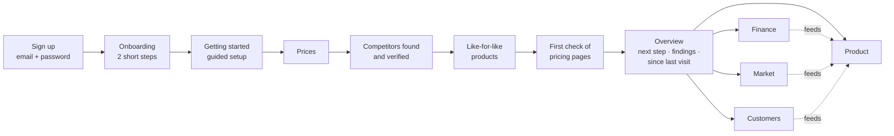
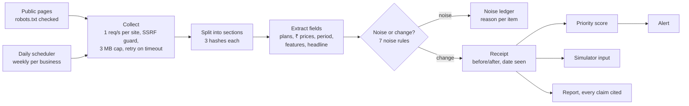
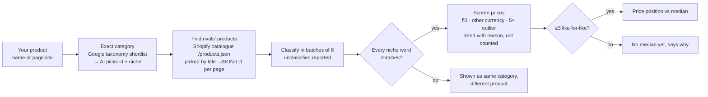
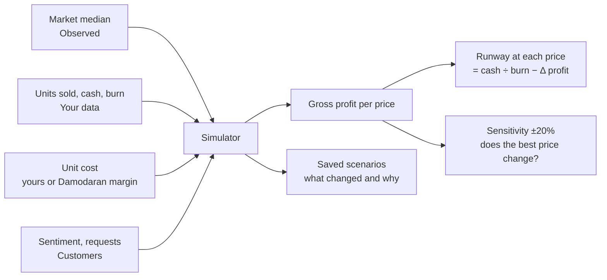
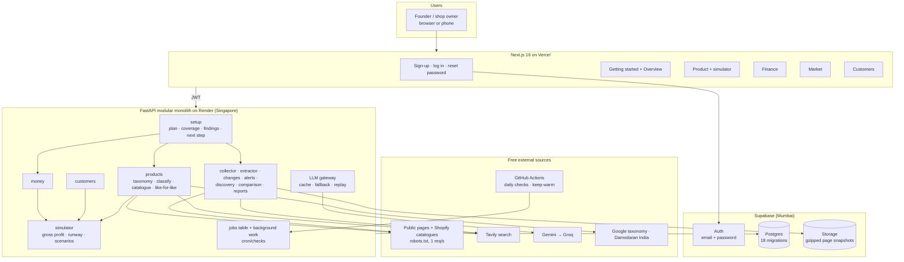

# HackNova'26 final-round deck: slide content

Content for the official 10-slide template (`HACKNOVA26_Final_Round_Presentation_Template.pptx`). Delete slide 11 (the instructions slide) before submitting.

**Updated 24 Oct 2026** for the final working version: phase two (Getting started, unified overview, data quality, decision engine, production hardening) is built and live. For the full technical and non-technical write-up, see `finalVersion.md` at the repository root.

Each slide below gives:
- the text to put on the slide
- the diagram, as Mermaid plus a layout note, so it can be redrawn in PowerPoint
- icon suggestions (names from the free [Lucide](https://lucide.dev) set)
- the screenshots to use (all in `docs/screenshots/`)
- speaker notes

**Labels used throughout:**
- **✅ Built**: works today on the live URL.
- **🛠 Future**: not built; listed as future scope.

Every slide must keep these two apart (template rule 10).

Placeholders to fill in: `[PRODUCT NAME]` (RivalLens is a working name; a live product called "Rival Lens" already exists, L-07), `[PS TITLE]`, `[TEAM]`.

---

## Slide 1: Project and problem statement details

| Field | Value |
|---|---|
| Project / Solution Title | **[PRODUCT NAME]: evidence-backed market intelligence for Indian startups and small businesses** |
| Problem Statement Title | `[PS TITLE]` (official title: Competitor Intelligence & Market Monitoring Agent; confirm the exact wording) |
| GitHub Repository Link | https://github.com/Niranjan-cyber/rivallens (**make it public before submitting**) |
| Live Prototype / Demo Link | https://rivallens-eight.vercel.app (create an account, or open a demo business from the login page: Stride & Co., Kesar Bakehouse, StackNest, QuickKart) |
| Figma / Design Link | Delete the row (there's no Figma file; the design system is `web/DESIGN.md` in the repo) |
| Team Name / Leader / Members | `[TEAM]` |

Speaker notes: none, since this slide is read, not presented.

---

## Slide 2: Problem statement and existing challenges

**Headline:** Small businesses can't see their market clearly, and the tools that try to show it either cry wolf or can't prove what they say.

**Context, with real numbers:**
- **2.23 lakh** DPIIT-recognised startups in India as of 31 Mar 2026, with **55,200** added in FY26 alone ([Inc42](https://inc42.com/buzz/centre-recognises-record-55200-startups-in-fy26/)).
- **7.83 crore** enterprises registered on Udyam as of 28 Feb 2026 ([IBEF, citing the Ministry of MSME](https://www.ibef.org/news/over-7-83-crore-enterprises-registered-on-udyam-platforms-indicating-strong-msme-formalisation-growth)).

**Who is affected:** first-time founders, D2C sellers, SaaS teams, local shops and service businesses. None of them has a market-research team.

**Existing challenges** (4 cards, one icon each):

| Icon | Challenge | Evidence |
|---|---|---|
| `eye-off` | **Competitor moves go unnoticed.** Nobody has time to check 8 or more competitors' pricing pages every week. | The problem statement asks for continuous monitoring with history |
| `bell-ring` | **Monitoring tools cry wolf.** A changed banner or reordered menu triggers an alert, so people stop trusting them. | False alerts are the top con for Visualping on G2 (30 mentions) ([G2](https://www.g2.com/products/visualping)) |
| `file-question` | **AI reports guess.** A one-off "competitor analysis" can't say when a price changed, compares unlike products, and states conclusions without enough data. | In our own tests a category-only match "priced" filter coffee powder against café cappuccinos (L-23) |
| `puzzle` | **Business data is scattered.** Sales sit in Excel or payment exports, reviews elsewhere, and none of it reaches the pricing decision. | Enterprise tools (Crayon, Klue) are built and priced for large sales teams |

**Diagram:** none. Use the two stat callouts on top and the 4 challenge cards below.

**Speaker notes (20 s):** "India adds about 150 startups a day. Each launches into a market someone else is already moving in. Today they check competitor sites by hand, or use a page-watcher that alerts on every banner change, or ask an AI that compares the wrong products. None of these says what actually changed, whether it's comparable, or what to do next."

---

## Slide 3: Proposed solution

**Headline:** Sign up, describe your business, and leave with trustworthy market intelligence and one concrete next step, all without help.

**How a founder moves through it:**

Layout note: top row is the guided flow (Getting started); bottom row is the Overview with the four dashboard tiles, with dotted arrows from Finance, Market and Customers into Product, since the price decision is made there.

**What the founder gets** (4 tiles):

| Icon | Area | What it shows | Status |
|---|---|---|---|
| `list-checks` | **Getting started + Overview** | One plan computed from saved data: steps with status, data coverage (Covered / Missing / Check failed / Out of date), findings that cite their evidence, and exactly one next step done in place. "Since your last visit" lists new competitor changes, reviews and failed checks. | ✅ |
| `package` | **Product** | Each product in one exact category, compared only with like-for-like products (≥3 before a median). Price position, premium examples, brand ranges, a suggested segment that must cite evidence, and a price simulator. | ✅ |
| `wallet` / `messages-square` | **Finance and Customers** | Revenue, margin, burn and runway from uploads, against India industry margins; competitors' revenue quoted from filings. Reviews and comments turned into sentiment and themes, each opening its quotes. | ✅ |
| `trending-up` | **Market** | Competitors found and verified for India. Pricing pages watched weekly; real changes get a dated receipt; redesign noise is ignored with the rule shown. Category prices and Indian market news. | ✅ |

**Trust rules** (one line each under the tiles):
- Every number is labelled **Observed** (public page, with link and date), **Your data** (uploaded or entered) or **Estimate** (benchmark or model).
- No conclusion without enough evidence: a market median needs 3 like-for-like prices; a gap over 60% is flagged as a likely size or pack mismatch; stale or failed data is shown as such.
- Demo businesses are built by running the same app on licensed datasets and are labelled *Demo business, modelled on …*.

**What makes it different** (4 short points with icons):
- `list-filter` **Noise ledger:** every ignored difference is listed with the rule that ignored it.
- `receipt` **Receipts:** every change keeps the saved page before and after, the highlighted value and the date seen.
- `git-compare` **Like-for-like or nothing:** every word naming the product type must match; outliers and other currencies are listed but not counted.
- `calculator` **Decisions tied to cash:** the simulator follows unit cost → gross profit → runway, calibrated to the product's real sales, and says which assumption could change the answer.

**Speaker notes (40 s):** "A founder signs up, describes the business, and the Getting started page does the rest with them: prices, competitors verified for India, products that are actually comparable, and a first check of competitors' pricing pages. The overview then says what we found, with evidence, and the one thing to do next. If the data isn't good enough, it says so instead of guessing."

---

## Slide 4: Technical approach and system workflow

**Headline:** Rules decide what changed and what is comparable; AI only drafts, classifies and summarises, and must cite evidence.

**Row 1, the monitoring loop** (✅ built):

**Row 2, like-for-like products** (✅ built):

**Row 3, the decision engine** (✅ built):

**Key logic** (bullets beside the diagrams):
- **Noise rules:** nav/header/footer, promo banner, formatting, whitespace, reordering, clocks and counters, text outside pricing. **Meaningful:** price up or down, plan added or removed, feature added or removed, headline change. Suspicious moves (over 80%, missing price, currency switch) are kept for review and never alert.
- **Like-for-like:** "Filter coffee powder" matches Toffee's and Third Wave's filter coffee, not protein coffee powder, a French press or a café cappuccino.
- **Simulator:** options at 0.85×, 1× and 1.15× the market median plus your price; conversion `c0·(p/M)^−e`; the best expected 12-month **gross profit** among options that break even in the worst case. An existing product is calibrated so today's price reproduces its real monthly sales.
- **Setup plan:** a pure function turns saved data into steps, coverage, findings and one next step (14 tests).
- **AI, free tier:** Gemini first, Groq as fallback; answers cached in Postgres; tests replay recorded answers. Never used to decide whether something changed.

Icons: `globe`, `scissors`, `filter`, `receipt`, `git-compare`, `calculator`, `gauge`, `bell`, `file-text`.

**Speaker notes (45 s):** "Top row: a cosmetic redesign gives 0 alerts and every ignored item is listed; a 40% price cut gives one alert with its receipt. Middle row: we read competitors' real catalogues and keep only products of the same kind; with fewer than three, we don't invent a median. Bottom row: the simulator follows the money. For Stride Runner it reproduces the 157 pairs a month in Finance, and at today's price its runway equals Finance's 19.4 months, which checks the whole chain."

---

## Slide 5: System architecture

**Headline:** One web app, one API, one database, all on free tiers. Every number has a source.

Layout note: five horizontal bands: Users → Web → API (modules grouped by area) → Data → Outside sources. Draw the **setup** module above the others with arrows to products, money and market, since it reads all of them.

**Data flow, in 4 numbered callouts:**
1. **Sign in.** The browser signs in with Supabase and sends its JWT on every API call. The service key never leaves the server. Every query is scoped to the signed-in user; a sweep of all 54 API routes confirms one user can't reach another's data.
2. **Setup.** `GET /profiles/{id}/setup` reads products, competitors, checks, Finance and Customers and returns steps, coverage, evidence-linked findings and one next step.
3. **Market and products.** Competitor pages are saved as unchangeable snapshots and diffed; rivals' products come from public catalogues and product pages, each with its link and date.
4. **Display.** The web app renders the API's JSON only. Scraped HTML never runs in the app; "View original" opens a sandboxed iframe through a 5-minute signed link.

**Module map:**

| Area | API modules | Main tables |
|---|---|---|
| Getting started / Overview | setup, profiles | profiles |
| Product | products (taxonomy, classify, market), simulator | products, market_products, product_scenarios |
| Finance | money | transactions, money_settings, money_facts |
| Market | collector, extractor, changes, alerts, discovery, comparison, reports | competitors, sources, snapshots, observations, change_events, alerts, reports |
| Customers | customers | customer_mentions, customer_insights, social_metrics |

Icons: `monitor`, `layout-dashboard`, `server`, `database`, `hard-drive`, `sparkles`, `search`, `shield-check`, `globe`, `clock`.

**Speaker notes (30 s):** "One API, one database, free tiers. The setup module sits on top and reads every dashboard to decide the next step. Jobs are a table plus background work, so a restart marks unfinished work as stale instead of losing it, and the setup page shows it."

---

## Slide 6: Technology stack and implementation

| Layer | Technology | Why |
|---|---|---|
| Web | Next.js 16 (App Router), React, Tailwind v4, Vercel | Git auto-deploy, print-to-PDF reports, works on phones |
| API | FastAPI, SQLAlchemy 2 (sync), psycopg 3, httpx, selectolax (lexbor) | Typed routes; a fast HTML parser that fits in 512 MB |
| Data | Supabase Postgres, Auth (email and password) and private Storage | One free provider for the database, sign-in and evidence files |
| AI | Gemini `flash-lite` → Groq `gpt-oss-120b` | Free, with fallback; answers cached and checked against a JSON schema |
| Search | Tavily (free 1,000 credits a month) | Competitor discovery, category news and funding |
| Product data | Shopify public catalogues (`/products.json`) and schema.org JSON-LD on product pages | Real, dated prices and features |
| Reference data | Google product taxonomy; Damodaran India margins; UCI Online Retail II (CC BY); The Bread Basket (CC0) | Exact categories, margin benchmarks, demo businesses |
| Scheduling | GitHub Actions (daily checks, keep-warm) | Free; the check endpoint only starts checks that are due, so it needs no secret |

**Database design** (small ER strip): profiles → competitors → sources → snapshots → observations → change_events (receipts) → alerts; profiles → products ↔ market_products (by taxonomy id and niche); products → product_scenarios; transactions, money_settings, money_facts; customer_mentions, customer_insights; jobs; reports.

**Testing, security and deployment** (3 columns):

- **Testing**
  - **92 automated tests** with recorded AI answers (`LLM_MODE=replay`), never live keys: noise rules, priority, taxonomy, like-for-like matching, catalogue picking, price screening, the setup plan, and the decision model against hand-worked numbers.
  - **Account isolation sweep:** every API route called without a token and as a second user with the first user's ids; all 54 pass.
  - **Live checks:** smoke script, overview on desktop and phone, simulator change-and-reset, and a brand-new founder walked end to end (`scripts/check-all.sh`).
- **Security**
  - robots.txt and per-site rate limits; an SSRF guard on every redirect.
  - Scraped HTML is never rendered in the app.
  - JWT checked on every call; someone else's ids look like missing ones (404).
  - Discovery limited per account; shared demo accounts can't change their password.
- **Deployment**
  - Git push auto-deploys Vercel and Render; versioned SQL migrations (18).
  - Daily scheduled competitor checks (weekly per business, next day after failed pages).
  - Reads retry while the free API wakes; failed requests show what failed with Try again.

Icons: `layers`, `test-tube`, `lock`, `rocket`.

---

## Slide 7: Prototype and key features

**Live link with a QR code:** https://rivallens-eight.vercel.app. Generate the QR from the link.

**Screenshots:** a 2×2 grid, all in `docs/screenshots/`.

| Screenshot | Caption |
|---|---|
| `m1-getting-started.png` | Getting started: every step with its status, one next step, findings and data coverage |
| `m1-overview-next-step.png` | Overview: "Stride Runner at ₹1,999 is 34% below the median of 9 like-for-like products", labelled Observed, with evidence |
| `ws4-simulator.png` | Simulator: runway at each price, editable assumptions with their origin, sensitivity, saved scenarios explaining what changed |
| `b14k-receipt.png` | Receipt: Monsoon Miles Downpour ₹2,999 → ₹1,799 (−40%), page before and after, date seen |

Optional extras: `b14k-noise-ledger.png` (0 meaningful, every ignored item with its rule), `ws2-overview-phone.png` (phone layout), `b14j-bakery-customers.png` (themes with quotes).

**Built** (everything below is live):

| ✅ Built and live |
|---|
| Email + password accounts; forgot password and change password; log out and back in keeps everything |
| Onboarding (2 steps) → **Getting started**: prices, competitors, like-for-like products and the first check done in place, with one next step and reasons whenever something can't be done |
| **Overview**: next step, top findings with evidence, "since your last visit", a status per dashboard |
| Add a product or service by name or page link, with an optional "who it's for" |
| Products in exact Google-taxonomy categories; services compared through competitors' pricing pages |
| Like-for-like comparison from real store catalogues and product pages; median only with ≥3; outliers and other currencies listed with the reason |
| Every number labelled Observed, Your data or Estimate; stale (14/30/90 days) and failed data flagged |
| Simulator: gross-profit break-even, calibration to real sales, runway at each price, launch cash path, editable assumptions, sensitivity, dated scenarios |
| Suggested customer segment that must cite its evidence |
| Finance: CSV/Excel uploads, revenue, margin vs Damodaran India, burn, runway; competitors' revenue quoted from filings |
| Customers: review and comment uploads → sentiment and themes with quotes |
| Market: competitor discovery verified for India; change detection, noise ledger, receipts, alerts; category prices; Indian market news |
| Daily scheduled competitor checks, with retry |
| Evidence-linked report + PDF; competitor history timeline |
| Four demo businesses built through the live app from licensed datasets and public pages |

**🛠 Future** (not built): see slide 9.

**Speaker notes (30 s):** "Everything here works on the link now. Create an account with your own business, or open Stride & Co. from the login page, change an assumption in the simulator, and watch the recommendation and the runway move."

---

## Slide 8: Feasibility, impact and benefits

**Technical feasibility:** runs today at **₹0 a month** on free tiers.

| Service | Free limit | How we stay within it |
|---|---|---|
| Gemini / Groq | Low requests per minute | Answers cached in Postgres; fallback model; batches of 8; empty answers never cached |
| Tavily | 1,000 credits a month | 3 searches per discovery; 5 discoveries per account a day; past the shared budget, discovery runs on AI suggestions, each still verified |
| Render | Sleeps after 15 min, 512 MB | Keep-warm ping; reads retry while it wakes; no headless browser |
| Supabase | 500 MB database, 1 GB storage | Snapshots gzipped |

**Operational feasibility:** a founder signs up, answers two short steps and follows one next step at a time. No integrations are needed; files can be uploaded instead.

**Risks and mitigations:**

| Risk | Mitigation |
|---|---|
| Sites block or change layout | robots.txt respected; failures shown as "Check failed", never as "no change"; retried the next day |
| Wrong comparisons | Every niche word must match; ≥3 prices for a median; big gaps flagged as size or pack mismatch |
| AI is wrong | Rules decide changes; AI suggestions must cite evidence or are dropped |
| Data trust | Every number labelled Observed / Your data / Estimate; demo data always labelled |

**Measured results from our own runs** (real, not projected):
- A cosmetic redesign produced **0 false alerts**; a 40% price cut was detected in **1 check** with its receipt.
- **5 brand-new businesses** walked live end to end (coffee roaster, wedding photographer, GST billing SaaS, sweets shop, gym): all reached a next step, all identical after logout and login.
- Real comparisons found live: cold brew bags against **12** real cold brew packs (Blue Tokai, Third Wave, Sleepy Owl); motichoor ladoo **11% below** the median (Bikanervala and others).
- The simulator reproduces Stride Runner's real **157 pairs a month**, and its runway at today's price equals Finance's **19.4 months**.
- **92** automated tests; **54** API routes pass the isolation sweep.

**Target users and benefits:** founders, D2C sellers, local shops, services and SaaS teams. They save weekly manual checks, get fewer and truer alerts, see only fair comparisons, and make price decisions tied to cash and runway.

Icons: `indian-rupee`, `shield-alert`, `users`, `timer`.

---

## Slide 9: Extra slide, data sources, limits and future scope

**Left half: the free, real data we use**

| Source | Used for | Licence or terms |
|---|---|---|
| Competitors' public pages | Prices, plans, features, history | robots.txt respected, 1 request/s |
| Shopify public catalogues and schema.org product data | Like-for-like product prices and features, with link and date | Public pages; robots.txt respected |
| [Google product taxonomy](https://support.google.com/merchants/answer/6324436) | Exact product category | Free to use |
| [Damodaran, margins by industry, India](https://pages.stern.nyu.edu/~adamodar/pc/datasets/marginIndia.xls) (NYU Stern, Jan 2026) | Margin benchmarks; estimated unit cost | Public academic data, with credit |
| [UCI Online Retail II](https://archive.ics.uci.edu/dataset/502/online+retail+ii) | Footwear demo business transactions | CC BY 4.0 |
| [The Bread Basket](https://api.openml.org/d/43422) | Bakery demo business transactions | CC0 |
| Listed companies' results (e.g. Campus Activewear FY26) | Competitor revenue and margins, quoted | Public filings and press, cited |
| Tavily search | Discovery, news, funding (each with a link) | Free tier |
| The company's own exports | Sales, costs, reviews | The company's own data |

**Honest limits today** (one line each):
- Price sensitivity is a default (1.2); the sensitivity check shows how much the answer depends on it.
- Services don't fit Google's product categories; they're compared through pricing pages.
- JavaScript-only or bot-blocking sites (quick commerce) can't be watched.
- Password reset emails need an SMTP sender (owner configuration).
- Pack size isn't normalised yet; large gaps are flagged instead.

**Right half: future scope** (🛠, paid or needs approval):
- Pack-size and unit normalisation (₹ per kg vs ₹ per box).
- Estimating price sensitivity from a founder's own price changes.
- Live Razorpay / Shopify / Tally sync; a verified email domain for alerts and resets.
- A headless browser for JavaScript-heavy pages; LLM help for pricing extraction.
- Instagram, Facebook and X data (app review or paid APIs).
- Team workspaces and roles; billing and plans; error tracking and uptime monitoring.

Icons: `database`, `scale` (licences), `triangle-alert` (limits), `telescope`.

---

## Slide 10: Thank you

- "Thank you! Questions & discussion" (keep the template text).
- Add: the live link and QR, the GitHub link, and one line: **"Ignore the noise. Compare like for like. Leave with one next step."**
- Speaker notes: invite judges to create an account with any real Indian business and follow Getting started, or open a demo business from the login page.
