# RivalLens (working name) — System Architecture

## 1. Overview

RivalLens helps founders and product or pricing teams of businesses in India track competitors. It takes a Business or Idea Card and automatically discovers competitors that operate in India. It then fetches their permitted public pages and extracts structured price, plan and feature fields. Each new snapshot is compared with the previous one. Cosmetic edits go to a visible **noise ledger**; real changes become **Change Receipts** backed by a stored snapshot. Each receipt re-runs a deterministic **launch simulator** and creates prioritized alerts (in the app and by email). Comparison, history and PDF reports are built from the same evidence store.

**Architecture style:** a **Next.js web app on Vercel** (UI, auth session, fictional mock competitor pages) calling a **FastAPI modular monolith on Render**. The monolith runs in-process background jobs for discovery and monitoring. **Supabase** provides Postgres, Auth and Storage. A small **LLM gateway** routes to Gemini (primary) or Groq (fallback) and caches every response in Postgres.

## 2. Constraints and decision log

| Item | Value | Source |
|---|---|---|
| Team | 1 person + AI coding agent ("you do everything") | stated |
| Deadline | Prototype deployed by ~21:00, 2026-10-23 (about 4.5 build hours from 16:15); official submission time unknown | stated |
| Deliverables | GitHub repo, PPT, deployed URL, technical write-up | stated |
| Stack | Next.js (TypeScript) frontend + FastAPI (Python) backend | stated (Q1) |
| Hosting | Vercel Hobby (frontend), Render Free web service (API), Supabase Free (DB, Auth, Storage) | stated accounts + researched |
| LLM | Free tiers only: Gemini primary, Groq fallback | stated |
| Search | Tavily free (1,000 credits/month, no card) | stated + researched (Brave's free tier now needs a card) |
| Email | Resend free (100/day) | stated + researched |
| Budget | $0/month for the prototype | assumed (free tiers only) |
| Scale | Demo: tens of users (judges as guests), 4 seeded profiles, ≤12 competitors per profile | assumed |
| Data sensitivity | Low: public web pages, user emails, business descriptions. No payment data | assumed |
| Compliance | Permitted public sources only; robots.txt respected; no auth/paywall/CAPTCHA bypass; polite rate limits | PS constraint |
| Phases | Prototype is built tonight; MVP and Production are **described only** (roadmap for the PPT) | stated (Q4) |

**Decision log:** 10 resolved · 6 assumed · 3 open.

Open questions:
1. Official submission time (affects freeze).
2. Do you own a domain you can verify on Resend? Without one, alert emails can only go to **your own** Resend account address.
3. The Gemini free-tier limits for your AI Studio project. Third-party reports range from about 20 to 1,500 requests per day. Check the limits page in the AI Studio console before relying on Gemini as primary.

### Upstream docs and conflicts

| Doc | Order | Status |
|---|---|---|
| `Competitor_Intelligence_Project_Refined.md` (concept doc, upload) | 1st | Partly superseded (scheduling, Playwright, Celery) |
| `hacknova26-competitor-intel-feature-scope.md` | 2nd | Partly superseded (auth); banner added |
| `hacknova26-competitor-intel-user-journeys.md` | 3rd | Current for use cases (UC-01–UC-15) and screens (S-01–S-19) |

| Fact | Doc A says | Doc B says | Taken as current | Why |
|---|---|---|---|---|
| Auth | Feature scope: **Won't**, hardcoded user | Journeys: real sign-up + login + guest clone | **Journeys** | Your later, deliberate choice |
| Backend | Concept doc: FastAPI | Feature scope: not fixed | **FastAPI** | Your stack answer (Q1) |
| Scheduling | Concept doc: APScheduler, Celery if needed | Scope and journeys: button-triggered | **Button in P1**, cron in P2, worker queue in P3 | Render Free sleeps, so in-process schedulers don't fire |
| Dynamic pages | Concept doc: Playwright | Scope: Could | **No Playwright in P1** | Fixtures: all 6 real pricing pages are server-rendered; Chromium doesn't fit Render Free's 512 MB |
| Notifications | Concept doc: email if time permits | Journeys: bell + center + email + PDF | **Journeys** | Latest |

## 3. Use cases in scope

| ID | Use case | Actor | Phase first supported |
|---|---|---|---|
| UC-01 | Sign up, log in, or try the demo account | Founder, PM, Judge | P1 |
| UC-02 | Create a Business or Idea Card (quick start + wizard) | Founder, PM | P1 |
| UC-03 | Discover competitors in India, review, add own, start monitoring | Founder, PM | P1 |
| UC-04 | Run monitoring; noise ledger | Founder, PM, Operator | P1 |
| UC-05 | Inspect a Change Receipt and evidence | All | P1 |
| UC-06 | Compare on configurable criteria | Founder, PM | P1 |
| UC-07 | Launch simulator + automatic re-plan | Founder | P1 |
| UC-08 | Alerts: bell, center, email | Founder, PM | P1 (email to own address only) |
| UC-09 | Evidence report + PDF | PM, Founder | P1 |
| UC-10 | Demo Lab: trigger and reset simulated changes | Operator, Judge | P1 |
| UC-11 | Competitor history (+ Wayback backfill) | Founder, PM | P1 (backfill: P1 Should) |
| UC-12 | Alert rules and sources configuration | Founder, PM | P1 (thin) |
| UC-13 | Switch business profiles | All | P1 |
| UC-14 | Viability risk flags for ideas | Founder (idea path) | P1 Should |
| UC-15 | Review themes | PM | P2 |

## 4. Context diagram

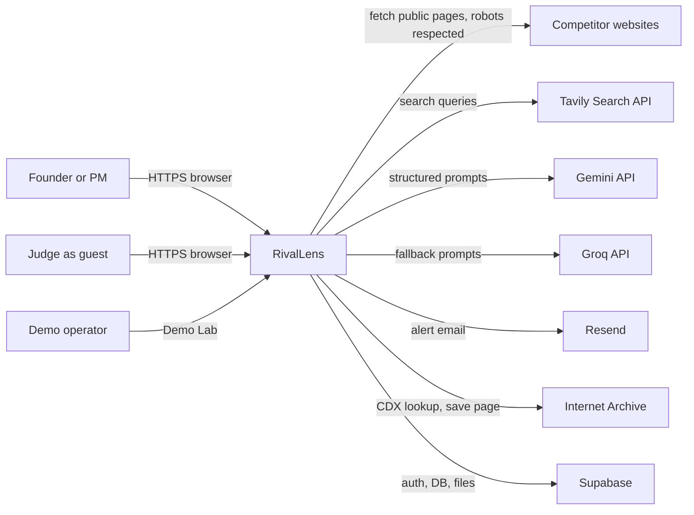

## 5. Container / component diagram (Production)

Components absent in earlier phases are marked in §6 and the HTML phase switcher.

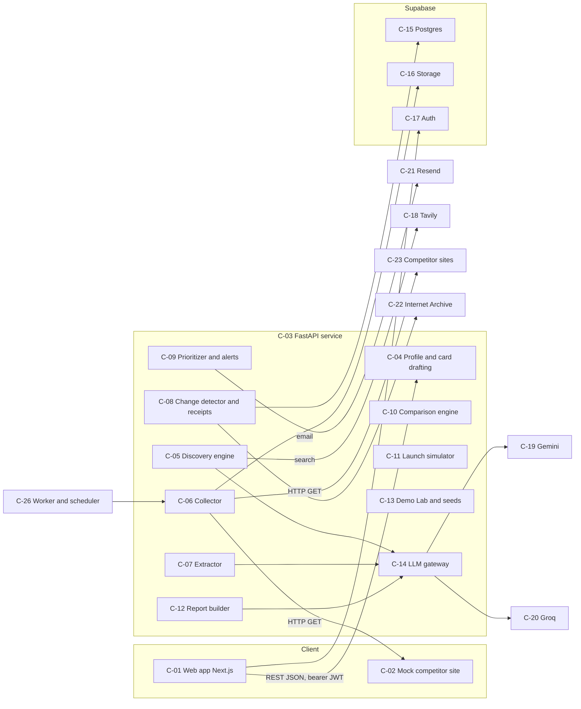

## 6. Components

| ID | Name | Layer | Responsibility | Technology | Serves (UC / NFR) | Phases |
|---|---|---|---|---|---|---|
| C-01 | Web app | client | All screens S-01–S-18, Supabase session, polling job status, print-to-PDF | Next.js 15 (App Router) + TypeScript + Tailwind + shadcn/ui + Recharts, on Vercel | UC-01–UC-14 | P1 P2 P3 |
| C-02 | Mock competitor site | client | Fictional pricing pages (S-19) per user instance, versioned by Demo Lab state; "Demo data" ribbon | Next.js dynamic route `/mock/[instance]/[slug]` (no-store), reads `mock_instances` | UC-10, UC-04 | P1 P2 P3 |
| C-03 | API service | service | REST `/api/v1`, JWT verification, per-user scoping, background jobs, job table | FastAPI + Uvicorn, Python 3.12, SQLAlchemy 2 + psycopg 3, on Render (Singapore) | all MVP UCs, NFR-security | P1 P2 P3 |
| C-04 | Profile & card drafting | service | Profiles CRUD; draft a card from a URL or one line via LLM; origin tags per field | module in C-03 | UC-02, UC-13 | P1 P2 P3 |
| C-05 | Discovery engine | service | LLM candidates + Tavily search → verify (reachable, robots, India signals) → TF-IDF similarity → find pricing page → LLM classify comparable/inspiration | module in C-03; Tavily; scikit-learn TF-IDF | UC-03 | P1 P2 P3 |
| C-06 | Collector | service | Polite fetch (robots.txt check, 1 req/s per host, timeout, User-Agent), store raw snapshot gz + visible text | httpx, `urllib.robotparser`, selectolax | UC-04, UC-03, NFR-compliance | P1 P2 P3 |
| C-07 | Extractor | ai | Segment page into sections, hash each; rule-based price detection; LLM structured extraction **only for new or changed sections** (cached) | module in C-03 + C-14 | UC-04, UC-11 | P1 P2 P3 |
| C-08 | Change detector & receipts | service | Field-level diff vs previous observation, noise rules → ledger, suspicious-change checks, receipt creation with excerpt offsets, Wayback lookup | module in C-03 | UC-04, UC-05, UC-11 | P1 P2 P3 |
| C-09 | Prioritizer & alerts | service | Explainable priority score, alert rules, dedupe, bell feed, Resend email | module in C-03 + Resend SDK | UC-08, UC-12 | P1 P2 P3 |
| C-10 | Comparison engine | service | Product/service criteria templates, weights, unknown-aware weighted score, INR normalization | module in C-03 | UC-06 | P1 P2 P3 |
| C-11 | Launch simulator | service | Deterministic scenario model (3 proposed options + user option, best/expected/worst), re-plan on receipt, viability flags for ideas | module in C-03 (pure Python) | UC-07, UC-14 | P1 P2 P3 |
| C-12 | Report builder | service | Assemble evidence-linked report JSON; LLM summary and suggestions block; drop unevidenced claims | module in C-03 + C-14 | UC-09 | P1 P2 P3 |
| C-13 | Demo Lab & seeds | service | Mock instance state and scenarios; clone seeded profiles into guest accounts; reset | module in C-03 | UC-10, UC-01 | P1 P2 P3 |
| C-14 | LLM gateway | ai | Provider routing (Gemini → Groq on 429/5xx/timeout), per-provider token bucket, JSON-schema validation and repair, Postgres response cache | module in C-03; `google-genai`, `groq` SDKs | UC-02, UC-03, UC-04, UC-09, NFR-cost | P1 P2 P3 |
| C-15 | Postgres | data | All relational data (§8) | Supabase Postgres (Free), via session pooler | all | P1 P2 P3 |
| C-16 | Object storage | data | Raw HTML snapshots (gzip), immutable | Supabase Storage bucket `snapshots` (private) | UC-05, NFR-evidence | P1 P2 P3 |
| C-17 | Auth | data | Email/password + anonymous sign-in (guest), JWT issuance | Supabase Auth | UC-01 | P1 P2 P3 |
| C-18 | Tavily | external | Web search for discovery | Tavily Search API (basic depth) | UC-03 | P1 P2 P3 |
| C-19 | Gemini | external | Primary LLM | Gemini API, Flash or Flash-Lite class model (pick the free model shown in AI Studio) | UC-02, UC-03, UC-04, UC-09 | P1 P2 P3 |
| C-20 | Groq | external | Fallback LLM | Groq API, Llama 3.3 70B class model | same as C-19 | P1 P2 P3 |
| C-21 | Resend | external | Alert email | Resend API | UC-08 | P1 P2 P3 |
| C-22 | Internet Archive | external | CDX lookups for permalinks and backfill; Save Page Now (P2) | Wayback CDX API (keyless) | UC-05, UC-11 | P1 P2 P3 |
| C-23 | Competitor websites | external | Monitored public pages | HTTP | UC-03, UC-04 | P1 P2 P3 |
| C-24 | CI/CD | infra | Push to `main` → Vercel and Render auto-deploy; P2 adds GitHub Actions tests | GitHub, Vercel Git, Render auto-deploy | NFR-delivery | P1 P2 P3 |
| C-25 | Keep-warm pinger | infra | `GET /healthz` every 10 min so Render Free doesn't sleep during judging | cron-job.org or GitHub Actions schedule | NFR-latency | P1 P2 |
| C-26 | Worker & scheduler | service | Scheduled monitoring and queued jobs off the request path; Playwright worker for JS pages | P2: Render Cron Job; P3: Redis + RQ worker(s) | UC-04, NFR-reliability | P2 P3 |
| C-27 | Observability | ops | Error tracking, structured logs, uptime | P2: Sentry (frontend and API) + Render logs; P3: + metrics dashboards | NFR-observability | P2 P3 |

## 7. Data flow

All long operations (draft, discovery, baseline, run, report) return a `job_id`. The web app polls `GET /api/v1/jobs/{id}` every 1.5 s. The browser calls the Render API directly (CORS allow-list), so Vercel function timeouts never apply.

### UC-01: Sign up, log in, or try the demo
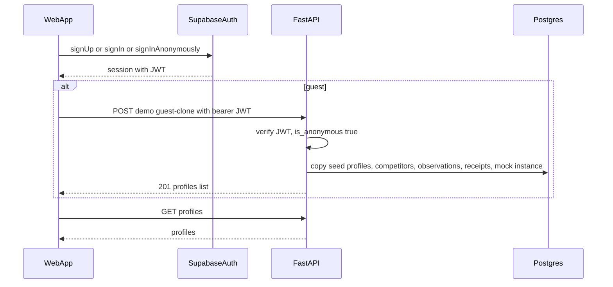
Failure: if the clone fails, the transaction rolls back and returns 500 `clone_failed`; the UI offers sign-up. Anonymous users are capped (§ specs 6).

### UC-02: Create a Business or Idea Card
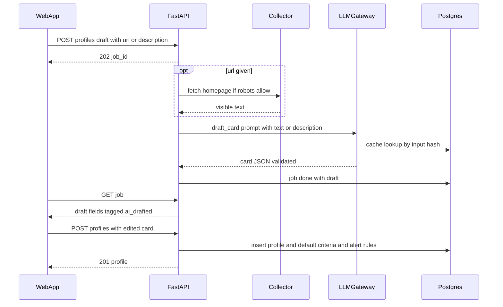
Failure: if the site is blocked or unreadable, the job returns `site_unreadable`; if the LLM fails on both providers, it returns `drafting_unavailable`. The UI falls back to the manual wizard.

### UC-03: Discover, review, confirm
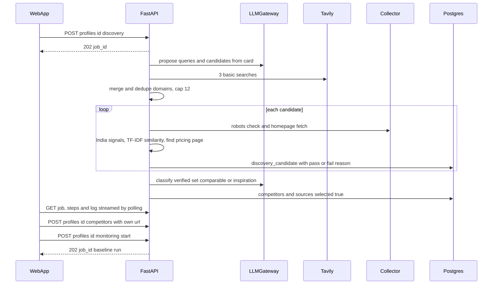
Failure: if 0 candidates pass, the job returns `no_verified_competitors`. For seeded profiles, an LLM or Tavily failure falls back to the stored discovery run. Guests over their limit get 429 `discovery_limit`.

### UC-04: Run monitoring and noise ledger
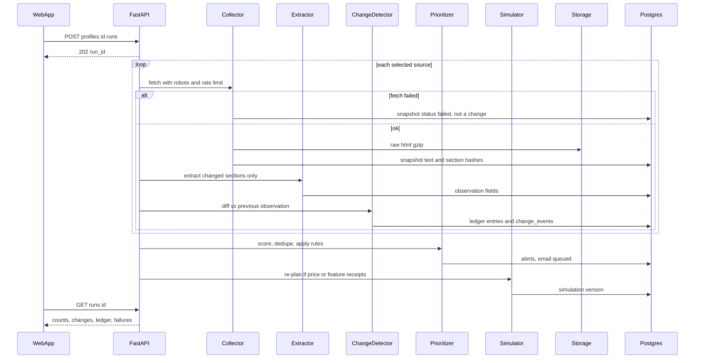
Failure: per-source errors never fail the whole run. A suspicious change gets `needs_review` and no alert. A run stuck longer than 10 min (instance restart) is marked `stale`, and the UI offers a re-run.

### UC-05: Inspect a Change Receipt
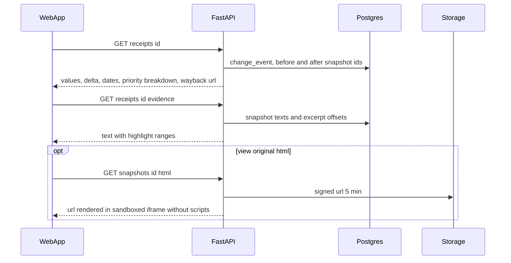
Failure: if a snapshot is missing, the response sets `evidence_missing: true` and the receipt is excluded from reports.

### UC-06: Compare on configurable criteria
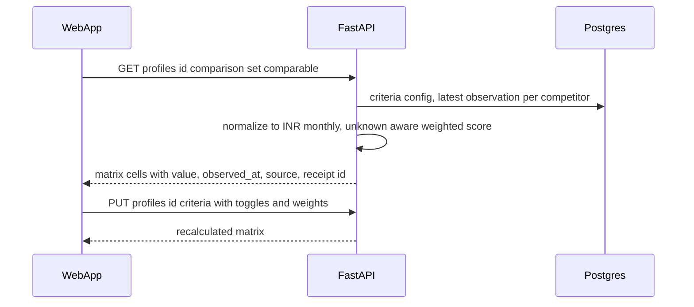

### UC-07: Launch simulator and re-plan
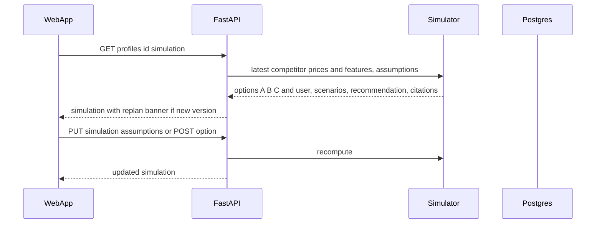
Failure: fewer than 2 priced competitors returns 409 `insufficient_price_data`.

### UC-08: Alerts
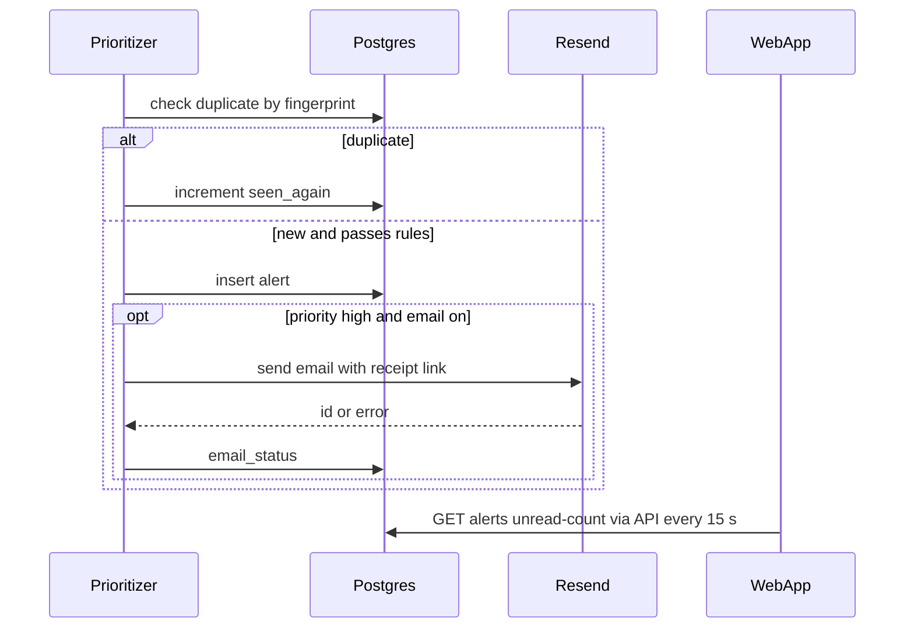

### UC-09: Evidence report
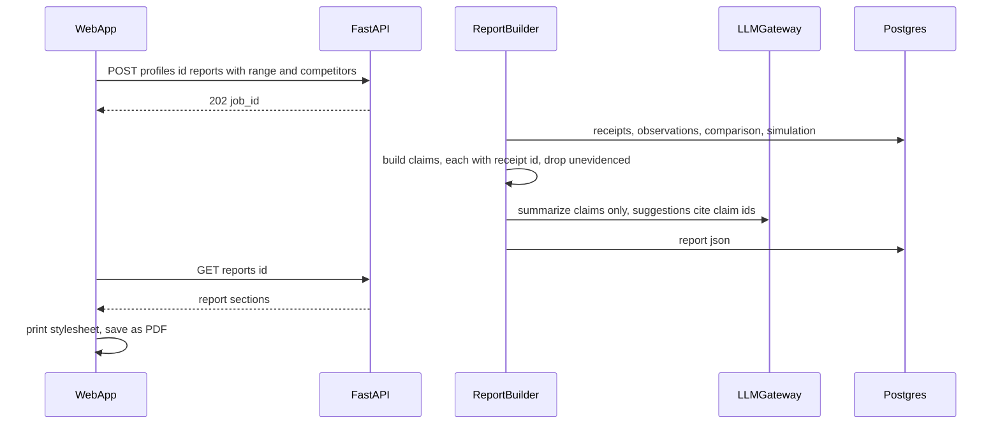
Failure: if the LLM fails, the report is rendered without a summary and `summary_unavailable` is set.

### UC-10: Demo Lab
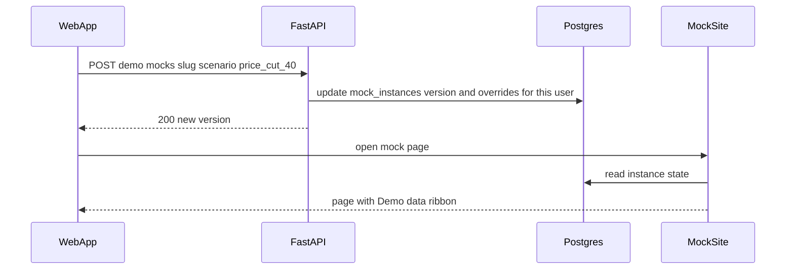

### UC-11: Competitor history
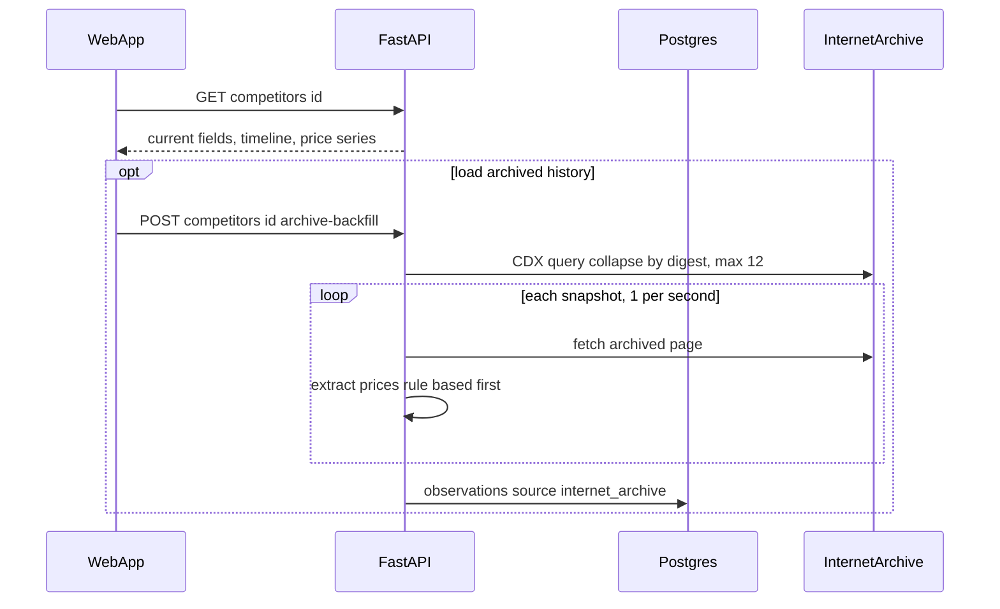

### UC-12: Alert rules and sources
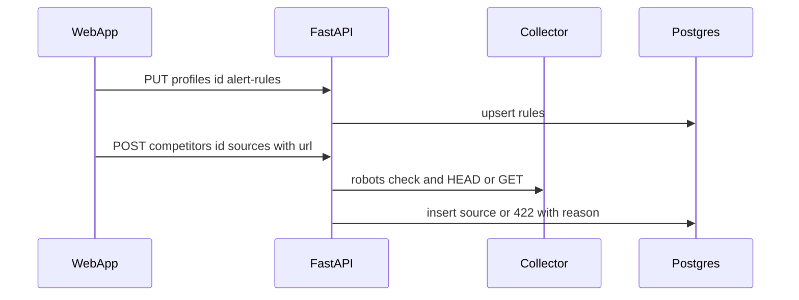

### UC-13: Switch profiles
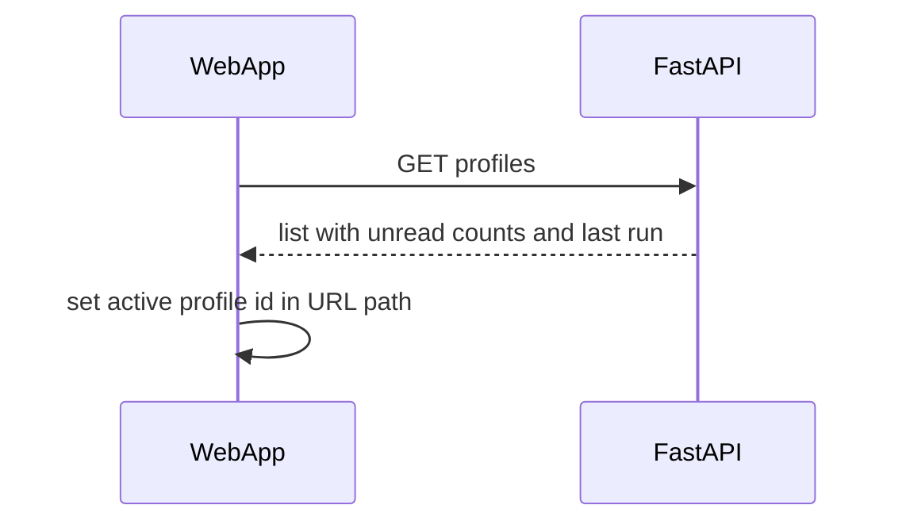

## 8. Data model

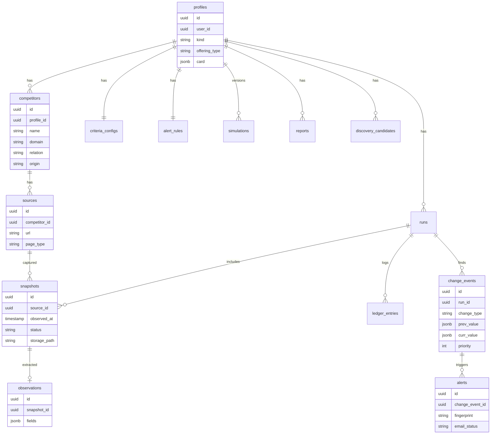

| Entity | Store | Key fields | Retention |
|---|---|---|---|
| profiles | C-15 | user_id, kind (business/idea), offering_type (product/service), card jsonb with per-field origin | until deleted |
| competitors, sources | C-15 | relation (comparable/inspiration), origin (ai_suggested/added_by_user/seed), india_signals, similarity | until deleted |
| snapshots | C-15 + C-16 | observed_at, status, text, section_hashes, raw html gz path, content sha256 | 90 days raw (P2 policy); text kept |
| observations | C-15 | extracted fields jsonb (plans, prices, currency, features, headline), extraction method | kept |
| runs, ledger_entries, change_events | C-15 | counts, reasons, prev/curr, excerpt offsets, published_at, wayback_url | kept (history) |
| alerts, alert_rules | C-15 | fingerprint, priority, read, email_status | kept |
| criteria_configs, simulations, reports | C-15 | weights, assumptions, options, results, claims with receipt ids | kept (versioned) |
| llm_cache, jobs, usage_counters | C-15 | input hash, provider, response; job steps; daily counters | cache 30 days; jobs 7 days |
| mock_instances | C-15 | owner user_id, instance_key, slug, version, overrides | until reset |

## 9. Deployment diagram (Production)

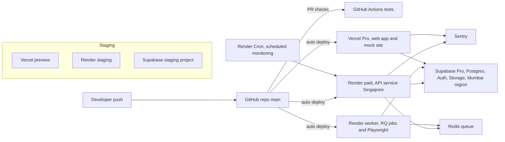

## 10. Phase architecture

| | P1 Prototype (tonight) | P2 MVP (described) | P3 Production (described) |
|---|---|---|---|
| Components | C-01–C-25 | C-01–C-27 | C-01–C-24, C-26, C-27 (C-25 removed) |
| Faked / stubbed | Simulated changes only on fictional mock pages (C-02); seeded profiles (quick commerce, shoes, quantum) with stored discovery runs and history, labelled demo data; review themes seeded; email only to the owner's address; no scheduled runs | Review themes still seeded; simulator heuristics not calibrated | Nothing faked; simulator calibration from user outcomes |
| Hosting and deploy target | Vercel Hobby + Render Free (Singapore) + Supabase Free; push-to-deploy | Render Starter (no sleep) + Render Cron; Supabase Free/Pro; verified email domain | Vercel Pro, Render Standard API + worker + Redis, Supabase Pro (Mumbai), staging environment |
| Auth, data, observability | Supabase email/password + anonymous; backend enforces `user_id` scoping; Render logs only | + email verification, password reset, per-user rate limits, Sentry, uptime check | + RLS defense-in-depth, audit log, backups and PITR, dashboards and alerts, source-permission registry |
| Est. monthly cost | $0 (free tiers; assumes ≤1 always-on Render service and ≤1,000 Tavily credits) | ~$15–55 (Render Starter $7, domain ~$1, optional Supabase Pro $25, small paid LLM usage) | ~$150–400 (Pro tiers, worker, Redis, paid LLM, Sentry), traffic-dependent |

**Delta P1 → P2:**
- **Added:** C-26 Render Cron calling `POST /internal/monitor-due` (scheduled monitoring, per-profile cadence) and C-27 Sentry.
- **Hardened:** Render moves from Free to Starter, so C-25 keep-warm is no longer needed. Email moves from `onboarding@resend.dev` to a verified domain sender. The GitHub Actions test suite runs with recorded LLM fixtures.
- **Migrations:** `profiles.monitor_cadence` column; SPN (Save Page Now) archiving on meaningful changes.

**Delta P2 → P3:**
- **Replaced:** in-process background jobs → Redis + RQ worker (C-26). The `jobs` table stays as the status store.
- **Added:** a Playwright worker for JS-rendered sources, staging environment, Supabase Mumbai region, RLS policies on all tables, and a source-permissions registry (per-domain ToS notes).
- **Migrations:** the job runner interface stays the same, so only the executor changes. Snapshot retention policy and storage lifecycle.

## 11. Key decisions (ADRs)

### ADR-01: Next.js on Vercel + FastAPI on Render
- **Context:** your stack choice. Python is strongest for scraping, diffing and the simulator; the UI needs polish fast.
- **Options:** TS monolith on Vercel · Next.js + FastAPI · FastAPI + server-rendered HTML.
- **Decision:** Next.js + FastAPI. The browser calls the API directly to avoid Vercel function timeouts. The API runs in Render's Singapore region (closest to India; Supabase in the same region).
- **Revisit if:** Render Free cold starts hurt the demo (→ Starter $7/month), or the two deploys cost too much time (→ move the API into Next route handlers).

### ADR-02: Supabase for Postgres, Auth and Storage
- **Context:** real login is required plus a no-friction guest; snapshots need durable storage, but Render Free's filesystem is wiped on spin-down.
- **Options:** Supabase · Neon + custom auth + S3 · Render Postgres (expires after 30 days on free).
- **Decision:** Supabase. One account gives email/password and **anonymous sign-ins** (included on free) for "Try demo account", Postgres (500 MB) and Storage (1 GB).
- **Revisit if:** the project pauses after 7 days of inactivity (open the dashboard before judging), or the DB exceeds 500 MB.

### ADR-03: In-process background jobs + job table (no queue in P1)
- **Context:** discovery and monitoring take 20–90 s; a single Render Free instance; 4.5 hours of build time.
- **Options:** FastAPI BackgroundTasks + `jobs` table polling · Redis queue · synchronous requests.
- **Decision:** BackgroundTasks running a job function that writes progress steps to `jobs`; the client polls.
- **Revisit if:** more than one API instance, or jobs lost on restarts (P3: RQ worker with the same job interface).

### ADR-04: Static HTML fetching, no headless browser in P1
- **Context:** fixtures show all 6 real pricing pages (Render, Railway, Netlify, Vercel, E2E Networks, DigitalOcean) contain their prices in server-rendered HTML. Chromium needs more than Render Free's 512 MB.
- **Decision:** httpx + selectolax. Pages that need JS are marked `needs_js` and skipped, not treated as changed.
- **Revisit if:** a key competitor is client-rendered (P3 Playwright worker).

### ADR-05: Section-hash gating + rules-first extraction
- **Context:** raw page hashes change on almost every capture (Render's pricing page has a new Wayback digest on nearly every snapshot). LLM free tiers are small (Groq ~12k tokens/min; Gemini limits uncertain).
- **Decision:** split visible text into sections by headings and landmarks and hash each normalized section. Unchanged sections reuse the previous extraction. Prices come from scoped regex first; the LLM is only called for new or changed pricing and feature sections, with input capped at 2,500 tokens.
- **Revisit if:** the rule-based pass misses prices on a key page (raise LLM use for that source only).

### ADR-06: LLM gateway with Gemini primary, Groq fallback and a Postgres cache
- **Context:** free tiers with unknown or low limits; the demo must replay deterministically.
- **Decision:** one `llm.complete_json(task, schema, input)` interface. It sends a cache key of sha256(task, model, input), checks the per-provider token bucket, falls back to Groq on 429, 5xx or a 20 s timeout, validates against a Pydantic schema and retries a repair once.
- **Revisit if:** both free tiers fail in rehearsal (switch the extraction task to rules only; summaries become templates).

### ADR-07: Tavily for discovery search
- **Context:** you need automated discovery without scraping search engines (ToS).
- **Options:** Tavily (1,000 credits/month, no card) · Brave (now a card-based monthly credit) · LLM knowledge only.
- **Decision:** Tavily basic search (1 credit each), 3 queries per discovery, combined with LLM-proposed candidates. Every candidate must pass HTTP verification, so an LLM-hallucinated company never reaches the list.
- **Revisit if:** credits run low (cache searches per card hash; fall back to LLM candidates + verification).

### ADR-08: Deterministic simulator; the LLM only explains
- **Context:** judges score evidence accuracy, and a simulator that invents numbers would undercut that.
- **Decision:** a pure-Python formula (specs §4.4) with editable, cited assumptions and a "scenario model, not a forecast" label. Viability flags are rules over evidence.
- **Revisit if:** real outcome data exists to calibrate against (P3).

### ADR-09: Per-user mock instances served by the web app
- **Context:** several judges using the Demo Lab at the same time must not change each other's mock pages; the fetcher should hit a real HTTP URL on a different host.
- **Decision:** `mock_instances` per user (guest clone creates one). C-02 renders `/mock/{instance_key}/{slug}` from that state with `no-store`.
- **Revisit if:** never needed beyond the demo.

### ADR-10: Evidence = immutable stored snapshot + excerpt offsets; never render scraped HTML live
- **Context:** links to live pages don't prove past claims, and scraped HTML can carry scripts (XSS).
- **Decision:** gzip raw HTML in a private bucket (path includes the sha256) plus visible text in the DB. Receipts store character offsets. The UI shows a text view with highlights by default. Original HTML opens only through a 5-minute signed URL in a sandboxed iframe with no `allow-scripts`. A Wayback permalink is added when CDX has a nearby capture.
- **Revisit if:** storage grows past 1 GB (retention policy in P2).

### ADR-11: PDF through the browser's print stylesheet
- **Decision:** S-15 has print CSS. Download PDF calls `window.print()`, so no server-side PDF library is needed on 512 MB.
- **Revisit if:** emailed PDFs are needed (P2: WeasyPrint on a paid instance).

### ADR-12: Store the observed currency; convert only for comparison
- **Context:** E2E Networks, an Indian provider, served USD prices to our fetch. The currency shown depends on region or locale.
- **Decision:** observations store the amount, currency and period exactly as seen. The comparison and simulator convert to INR per month with a configurable `USD_INR_RATE` assumption, shown in the UI.
- **Revisit if:** sources show both currencies (prefer INR when present).

## 12. Non-functional requirements

| NFR | Prototype | MVP | Production |
|---|---|---|---|
| Latency | UI actions under 1 s; discovery under 90 s; run for 6 sources under 60 s; cold start avoided with keep-warm | Same, without sleep | Runs queued; p95 API under 500 ms |
| Availability | Best effort; demo-time warm-up | 99% (single instance) | 99.5%, staging + prod |
| Security | Supabase JWT verified on every API call; user_id scoping; CORS allow-list; secrets in env; sandboxed evidence | + rate limits per user, email verification | + RLS, audit log, dependency scanning |
| Privacy | Only user email + business info; guests anonymous | Privacy note + delete account | DPDP Act (India) review |
| Compliance | robots.txt check per fetch, 1 req/s per host, identified User-Agent, no login or paywall content | + per-domain ToS registry | + legal review of sources |
| Cost ceiling | $0 | ≤ $55/month | budget alerts |
| Observability | Render + Vercel logs; `jobs` table step logs; LLM usage counters | Sentry, uptime monitor | dashboards: runs, failures, LLM spend, alert volume |
| Evidence integrity | Every receipt has a snapshot, observed_at and offsets; unevidenced claims dropped from reports | + Wayback SPN on meaningful changes | + snapshot hash verification job |

## 13. Risks

| Risk | Likelihood | Impact | Mitigation | Phase |
|---|---|---|---|---|
| Gemini free RPD lower than needed (reports say 20–1,500) | Med | High | Check AI Studio limits now; Groq fallback; cache; seeded baselines; tests never use live keys | P1 |
| Groq ~12k tokens/min throttles baseline extraction | High | Med | Section gating, 2,500-token cap, rules-first prices, token bucket, baseline for seeded profiles precomputed | P1 |
| Tests or rehearsals burn the same LLM quota as the demo | High | High | Recorded LLM fixtures in tests; separate rehearsal key/project if possible; `LLM_MODE=replay` for rehearsal | P1 |
| Render Free cold start during judging (~1 min) | High | High | C-25 keep-warm ping every 10 min; open the URL 5 min before; Render Starter $7 if needed | P1 |
| Supabase direct DB host is IPv6-only on free (verify) | Med | High | Use the session pooler connection string | P1 |
| Resend can only email your own address | Certain (no domain) | Low | Demo email to your own account email; `ALERT_EMAIL_OVERRIDE`; verify a domain in P2 | P1 |
| Real sites change markup or block | Med | Med | Live demo runs on mock pages; failed fetch ≠ change; `needs_review` on suspicious values | P1 |
| Regex picks non-plan numbers (credits, big "$829,000" stats) | High | Med | Restrict price detection to pricing sections near plan headings; LLM confirms on changed sections; plausibility bounds | P1 |
| Currency differs by region | Med | Med | ADR-12 | P1 |
| Background job lost on instance restart | Low | Med | `stale` detection + re-run button | P1 |
| Judges' guest data or abuse (many discoveries) | Med | Med | Anonymous caps: 2 live discoveries/day/user, 20/day global | P1 |
| Scope: 13 MVP use cases + auth in about 4.5 h | High | High | Build planner must checkpoint (deployed skeleton first) | P1 |

## 14. Handoff to build planning

- **Provider budget mitigations:**
  - recorded LLM fixtures for tests (`LLM_MODE=replay`)
  - token buckets per provider
  - LLM cache table
  - seeded baselines precomputed
  - keep-warm pinger
  - check the Gemini limits in AI Studio first
  - Tavily search cache by card hash
- **Fixtures:**
  - real pricing pages, robots.txt files and Wayback CDX JSON are in `fixtures/`
  - **still missing:** Gemini, Groq, Tavily and Resend responses. Those specs are doc-based and unverified; record the first live responses into `fixtures/llm/`, `fixtures/tavily/` and `fixtures/resend/`
  - quick-commerce and shoe-brand pages not fetched yet
- **Seed data to prepare:**
  - 4 seeded profiles with stored discovery runs, observations and receipts
  - 2–3 fictional mock competitors (NimbusDeploy (demo) and others) with v1, v2 and cosmetic variants
- **Open questions awaiting you:** submission time; email domain; Gemini limits.
- **Migrations between phases (described only):** BackgroundTasks → RQ worker; Render Free → Starter; resend.dev → verified domain; add RLS policies.

## 15. Sources

- [Render Free docs](https://render.com/docs/free): spin-down after 15 min, ~1 min cold start, 750 h/month, ephemeral filesystem, free Postgres expires in 30 days.
- [Render changelog Feb 2026](https://render-www.onrender.com/changelog/free-web-services-now-remain-active-while-receiving-websocket-messages): WebSocket messages also reset the idle timer.
- [Supabase pricing](https://supabase.com/pricing): Free 500 MB DB, 1 GB storage, 50k MAU, anonymous sign-ins included, pause after 1 week of inactivity.
- [Tavily credits docs](https://docs.tavily.com/documentation/api-credits.md): 1,000 free credits/month, basic = 1 credit, advanced = 2.
- [Brave Search API 2026 notes](https://agentdeals.dev/vendor/brave-search-api): the free plan changed to a card-based monthly credit (third-party; informed ADR-07).
- [Resend 403 for resend.dev](https://resend.com/docs/knowledge-base/403-error-resend-dev-domain): the testing domain only sends to the account owner.
- [Resend free tier summary](https://automationatlas.io/answers/resend-free-tier-explained-2026/): 100/day, 3,000/month (third-party).
- [Groq rate limits docs](https://console.groq.com/docs/rate-limits) and [OpenRouter free LLM comparison](https://openrouter.ai/blog/tutorials/free-llm-apis-compared/): Llama 3.3 70B free ~30 RPM / 1,000 RPD / 12k TPM (third-party figures; verify in the console).
- [Gemini free tier analyses](https://agentdeals.dev/gemini-api-pricing-changes), [tinkerllm](https://tinkerllm.com/blog/gemini-api-free-tier-limits-rate-quotas/): conflicting free-tier limits; per-project quotas; daily reset at Pacific midnight.
- [Mastra competitor monitor template](https://mastra.ai/templates/competitor-monitor-jev): reference for an ignore/record/review/alert policy and before/after excerpts.
- [changedetection.io](https://github.com/dgtlmoon/changedetection.io): reference for filter-based change detection.
- [Wayback CDX API](https://web.archive.org/cdx/search/cdx?url=render.com/pricing&output=json): verified keyless; digest churn observed.
- Fixtures fetched 2026-10-23 (see `fixtures/README.md`).
