# RivalLens (working name): User Journeys & Flows

> Tell us your business. We find your Indian-market competitors, watch what they change, prove it, and show what it means for your launch.

*Working name only; rename freely. All company names in examples marked (fictional) or (demo) are invented.*

## 1. Project summary

RivalLens is a desktop-first web app for founders and product or pricing teams of businesses in India. The flow works like this:

1. A user signs up, or a judge clicks **Try demo account**.
2. They describe their business or idea in one line or paste their website. The free LLM drafts a **Business Card** or **Idea Card**, which the user corrects in a 3-step wizard.
3. The system **discovers competitors operating in India** automatically. That includes foreign companies serving India, split into *comparable* and *inspiration*. The user reviews the list, can deselect or add a competitor URL, and starts monitoring.
4. Each **monitoring run** fetches permitted public pages, extracts prices, plans and features, and compares them with the previous snapshot. It logs cosmetic edits in a visible **noise ledger** and turns real changes into **Change Receipts**: before and after values, observed-at timestamp, and a saved snapshot of the page with the excerpt highlighted.
5. Each receipt re-runs the **launch simulator**. The simulator proposes three price options with cited, editable assumptions and shows best, expected and worst cases.
6. Users compare competitors on criteria that adapt to products vs services, and get prioritized alerts in the app and by email. They can download an evidence-linked report as a PDF.
7. A labelled **Demo Lab** lets the presenter introduce a simulated change on fictional mock competitor pages.

Constraints: solo builder plus an AI agent, about 4.5 build hours, free LLM tier only. The GitHub repo, PPT and deployed URL are required.

**Doubt log**

| # | Question | Status | Answer / assumption |
|---|----------|--------|---------------------|
| 1 | How does one person see several business profiles? | Resolved | Real sign-up and login; each account owns several profiles; a profile switcher sits in the top bar |
| 2 | What happens between discovery and monitoring? | Resolved | Review the discovered list (all pre-selected), deselect, optionally **add your own competitor URL**, then start monitoring |
| 3 | Where is the simulated change triggered? | Resolved | A clearly labelled **Demo Lab** screen inside the app |
| 4 | Can judges create profiles and run live discovery? | Resolved | Yes, with guardrails: rate-limited; on failure the error is explained and seeded profiles stay available |
| 5 | Onboarding style? | Resolved | Path choice (business vs idea) → **quick start** (one line or a website URL, the LLM drafts the card) → **3-step wizard** pre-filled for editing |
| 6 | Who proposes simulator alternatives? | Resolved | The system proposes 3 options (below, at or above the competitor median, cited); the user edits assumptions and can add an option |
| 7 | Output channels? | Resolved | In-app bell and alert center, email alert, report PDF download (no shareable link) |
| 8 | How do judges avoid sign-up friction? | Assumed | **Try demo account** creates a fresh guest account cloned from the seeded profiles, so judges don't see each other's data |
| 9 | What does the user land on after login? | Assumed | Home = list of the user's business profiles with unread alerts and last-run time |
| 10 | Where are comparison criteria configured? | Assumed | Inline on the Comparison screen (toggle criteria, set weights) |
| 11 | Where are alert rules configured? | Assumed | Per-profile Settings screen (change types, minimum priority, email on or off) |
| 12 | Monitoring trigger? | Assumed | **Run monitor** button; scheduled runs are Could tier |
| 13 | Platform? | Assumed | Web, desktop-first; must stay usable on a phone for the email-to-receipt moment |

## 2. Personas

### P1: Riya, co-founder of *StackNest* (fictional), a Pune cloud-deployment startup ⭐ primary
- **Goal:** set the Pro plan price for a paid launch next quarter without being undercut by Vercel, Render, Railway or Indian providers, and know quickly when a competitor moves.
- **Context of use:** laptop at work, a few times a week; checks alert emails on a phone.
- **Frustration today:** checks 6-8 pricing pages by hand, misses changes, can't remember what a page said last month, and gets false alarms from generic page-change tools.
- **Tech comfort:** high.

### P2: Kabir, pricing & category lead at *Stride & Co.* (fictional), a D2C shoe brand
- **Goal:** track competitor brands' prices, new launches and positioning for running shoes, and justify price changes to their manager with evidence.
- **Context of use:** laptop at the office, daily; shares PDF reports in weekly reviews.
- **Frustration today:** spreadsheets of screenshots, no dates, and claims their manager can't verify.
- **Tech comfort:** medium.

### P3: Judge / evaluator at HackNova'26
- **Goal:** within about 5 minutes on the deployed URL, verify that monitoring, change detection, history, comparison, evidence links, alerts and reports actually work.
- **Context of use:** laptop at the judging table, once, under time pressure.
- **Frustration today:** demos that only work on the presenter's laptop, and claims with no evidence.
- **Tech comfort:** high.

### P4: Demo operator (you)
- **Goal:** trigger a believable, clearly labelled simulated competitor change on cue and reset afterwards.
- **Context of use:** on stage, one shot.
- **Frustration today:** live scraping that breaks during a demo.
- **Tech comfort:** high.

*The quick-commerce and quantum-computing businesses are **seeded profiles** inside the demo account, not separate personas. The quantum profile exercises the **Idea Card** path and the viability flags.*

## 3. Use cases

| ID | Actor | Goal | Trigger | Priority |
|----|-------|------|---------|----------|
| UC-01 | P1, P2, P3 | Sign up, log in, or try the demo account | Lands on the site | MVP |
| UC-02 | P1, P2 | Create a Business or Idea Card | No profile yet, or "+ New profile" | MVP |
| UC-03 | P1, P2 | Discover competitors in India, review them, add own, start monitoring | Card confirmed | MVP |
| UC-04 | P1, P2, P4 | Run monitoring and see what changed vs what was ignored | "Run monitor" | MVP |
| UC-05 | P1, P2, P3 | Inspect a Change Receipt and its saved evidence | Clicks a change, alert or report claim | MVP |
| UC-06 | P1, P2 | Compare competitors on configurable criteria | Opens Comparison | MVP |
| UC-07 | P1 | Simulate launch options and see re-plans after changes | Opens Simulator, or a receipt triggers a re-plan | MVP |
| UC-08 | P1, P2 | Receive and act on alerts (bell, center, email) | Meaningful change detected | MVP (email: Should) |
| UC-09 | P2, P1 | Generate and download an evidence-linked report | "Generate report" | MVP |
| UC-10 | P4, P3 | Trigger and reset a simulated change in the Demo Lab | Demo cue | MVP |
| UC-11 | P1, P2 | Browse a competitor's history over time | Opens a competitor | MVP (Wayback backfill: Should) |
| UC-12 | P1, P2 | Configure alert rules and monitored sources | Too many or too few alerts | MVP (thin) |
| UC-13 | P1, P2, P3 | Switch between business profiles | Top-bar switcher | MVP |
| UC-14 | P1 (idea path) | See evidence-backed viability risk flags for an idea | Opens an Idea profile's simulator | Should |
| UC-15 | P2 | Compare customer review themes | Opens the Reviews tab | Later (seeded if time) |

### UC-01: Sign up, log in, or try the demo account
- **Preconditions:** none.
- **Main path:**
  1. On S-01 Landing, click **Sign up**.
  2. On S-02, enter name, email and password.
  3. The account is created and the user lands on S-03 Home, which is empty with a "Create your first profile" prompt.
- **Alternate paths:**
  - **Log in** with existing credentials lands on S-03 showing their profiles.
  - **Try demo account** creates a guest account cloned from the seeds (StackNest, a quick-commerce profile, Stride & Co., the quantum idea) and lands on S-03.
- **Error paths:**
  - Wrong password shows an inline error with a retry option.
  - Email already registered offers **Log in** instead.
  - If guest cloning fails, the user sees "Demo unavailable, try again" and sign-up stays available.
- **Outcome:** the user is authenticated and on Home.

### UC-02: Create a Business or Idea Card
- **Preconditions:** logged in.
- **Main path:**
  1. On S-04, pick **I run a business** or **I have an idea**.
  2. Paste the website URL or describe the business in one line, then click **Draft my card**.
  3. The LLM drafts the fields.
  4. The S-05 wizard opens pre-filled. **Basics** covers name, website, industry and India market or cities. **Offering** covers product vs service, category, key attributes and current or planned price with billing period. **Priorities** covers what to watch and the criteria that matter.
  5. AI-drafted fields carry a badge until edited.
  6. S-06 Card preview, then **Find competitors**.
- **Alternate paths:**
  - **Fill manually** skips the draft, so the wizard starts empty.
  - The idea path asks for problem, target customer, planned features and intended price instead of a website.
- **Error paths:**
  - If the website can't be fetched or robots.txt disallows it, the user sees "Couldn't read your site, describe it instead".
  - If the LLM is rate-limited or down, the user sees "Drafting unavailable, fill manually".
  - Required fields missing blocks **Next** and highlights the fields.
- **Outcome:** a saved profile with a Business or Idea Card.

### UC-03: Discover competitors in India, review them, add own, start monitoring
- **Preconditions:** a card exists.
- **Main path:**
  1. S-07 Discovery shows live steps:
     - generating candidates (AI-suggested)
     - verifying each site is reachable and robots.txt allows it
     - checking India signals (₹/INR, .in, India region or address)
     - ranking by similarity to the card
     - finding pricing and features pages
  2. S-08 Review shows **Comparable** and **Inspiration** tabs, all pre-selected. Each competitor shows its India signals, similarity score, pages to watch and evidence links.
  3. The user deselects any that don't fit and clicks **Start monitoring**, which runs a baseline and opens S-09 Dashboard.
- **Alternate paths:**
  - **Add competitor URL**: the system validates it (reachable, robots.txt, India signal shown as "unverified" if missing) and adds it as "Added by you".
  - Re-run discovery with an edited card.
- **Error paths:**
  - If discovery finds nothing that passes the checks, the user sees "No verified competitors yet" with **Add competitor URL** or **Edit card**.
  - For seeded profiles only, an LLM or search failure falls back to the saved discovery run, labelled with its date.
  - A competitor whose pages are blocked by robots.txt is shown greyed out as "not monitorable".
  - The rate limit for guest accounts shows "Live discovery limit reached; explore the seeded profiles".
- **Outcome:** a confirmed competitor and source list with a baseline snapshot per page.

### UC-04: Run monitoring and see what changed vs what was ignored
- **Preconditions:** monitored sources exist.
- **Main path:**
  1. Click **Run monitor** on S-09.
  2. Progress shows per source.
  3. S-10 Run result shows a headline such as "17 page diffs · 15 ignored · 2 meaningful". The meaningful changes list links to receipts; the noise ledger lists each ignored diff with its reason (navigation, footer, banner, formatting only, reordering).
  4. Alerts are created.
- **Alternate paths:** no changes shows "Nothing new since <time>", and the ledger still lists anything ignored.
- **Error paths:**
  - A failed fetch or extraction is recorded as **Failed (not a change)** with a retry option, and no alert is sent.
  - A suspicious change (a price vanished, a value jumped over 80%) is flagged **Needs review** rather than alerted.
- **Outcome:** stored snapshots, receipts and alerts.

### UC-05: Inspect a Change Receipt and its saved evidence
- **Preconditions:** at least one receipt.
- **Main path:**
  1. Open S-11 from S-10, an alert or a report claim.
  2. See the change type, previous and current values, and Δ%.
  3. See the observed-at timestamp, plus published-at if known, or "unknown, the change happened between <prev obs> and <obs>".
  4. View the before and after snapshots side by side with the excerpt highlighted.
  5. Use the source URL and Wayback permalink where available.
  6. See how the priority score was computed and the simulator impact.
- **Alternate paths:** mark the change **Not relevant**, which mutes similar changes and feeds the noise rules.
- **Error paths:** if no snapshot was stored (storage failed), the receipt shows "evidence missing" and is excluded from reports.
- **Outcome:** the claim can be checked against its evidence.

### UC-06: Compare competitors on configurable criteria
- **Preconditions:** baseline exists.
- **Main path:**
  1. S-13 loads the criteria template for products or services. Services cover plan price, free tier, region in India, support, features and positioning. Products cover price, key specs, variants, ratings and positioning.
  2. Each cell shows its value, observed date and source.
  3. The user toggles criteria and sets weights, and the weighted score updates.
- **Alternate paths:** switch between Comparable and Inspiration sets.
- **Error paths:** a missing value shows **Unknown**, which is excluded from the weighted score (never counted as zero), with a note on how many cells are unknown.
- **Outcome:** a sourced side-by-side view.

### UC-07: Simulate launch options and see re-plans
- **Preconditions:** the card has a planned price, or a price range for ideas; at least 2 competitors have prices.
- **Main path:**
  1. On S-14, the system proposes options A, B and C below, at and above the competitor median, each citing the receipts or observations used.
  2. The assumptions panel shows segment size, elasticity and conversion range, all editable, with sources or "your assumption".
  3. Best, expected and worst-case results appear per option, with the recommended option and why.
  4. After a new receipt, a **Re-planned** banner shows "Recommended ₹999 → ₹849 because NimbusDeploy (demo) Pro −40%".
- **Alternate paths:** **Add my own option**; reset assumptions.
- **Error paths:** if there's too little price data, the user sees "Need at least 2 priced competitors" with a link to S-08.
- **Outcome:** a scenario comparison labelled "scenario model, not a forecast".

### UC-08: Receive and act on alerts
- **Preconditions:** alert rules exist (defaults are on).
- **Main path:**
  1. The bell badge increments.
  2. The dropdown shows the top alerts: one-line explanation, priority and observed date.
  3. Click one to open S-11, or **View all** to open S-16.
  4. A high-priority alert also sends an email with the previous vs current value and a receipt link.
- **Alternate paths:** mark read, mute this competitor or change type, filter by profile, priority or type.
- **Error paths:**
  - A duplicate change (same field, same new value) isn't re-alerted, and S-16 shows "seen again".
  - Failed email delivery is logged on the alert as "email failed", and the in-app alert remains.
- **Outcome:** the user sees the important change without noise.

### UC-09: Generate and download an evidence-linked report
- **Preconditions:** a baseline exists.
- **Main path:**
  1. On S-15, pick the date range and competitors, then click **Generate**.
  2. Sections appear: summary of key changes, comparison, price and feature changes over time, simulator implications, data limitations.
  3. Every fact links to a receipt. AI suggestions sit in a separate, labelled block citing the evidence behind them.
  4. **Download PDF**.
- **Alternate paths:** regenerate after a new run.
- **Error paths:**
  - If the LLM summary fails, the report renders from the structured data only, with "summary unavailable".
  - Claims without evidence are dropped and listed under limitations.
- **Outcome:** a PDF with source links and observation dates.

### UC-10: Trigger and reset a simulated change in the Demo Lab
- **Preconditions:** logged in; the mock competitor pages exist.
- **Main path:**
  1. S-18 lists the mock competitors (NimbusDeploy (demo), etc.) with their current version.
  2. Click a scenario: **Cut Pro price 40%**, **Add feature**, **Change positioning headline** or **Cosmetic-only change** (nav and banner, to prove noise filtering).
  3. The mock page (S-19) updates with a "Demo data" banner.
  4. Return to S-09 and click **Run monitor**.
- **Alternate paths:** **Reset all mocks to v1**.
- **Error paths:** if the mock page fails to update, show the error and leave the version unchanged.
- **Outcome:** a labelled simulated change ready to be detected.

### UC-11: Browse a competitor's history
- **Preconditions:** the competitor is monitored.
- **Main path:**
  1. Open S-12 from S-08, S-09 or S-13.
  2. See current extracted fields with observed dates.
  3. A timeline of receipts and runs, including failed ones.
  4. A price history chart.
- **Alternate paths:** **Load archived history** pulls Wayback snapshots as backfill (Should), labelled with the source "Internet Archive".
- **Error paths:** if there are no archived snapshots, show "No archive history available".
- **Outcome:** a dated record of how the competitor changed.

### UC-12: Configure alert rules and monitored sources
- **Preconditions:** a profile exists.
- **Main path:**
  1. On S-17, toggle change types (price, feature, plan structure, announcement, positioning).
  2. Set the minimum priority and switch email on or off.
  3. See the monitored pages per competitor and remove or add one.
- **Error paths:** an invalid URL or one blocked by robots.txt is rejected with the reason.
- **Outcome:** fewer, more relevant alerts.

### UC-13: Switch between business profiles
- **Main path:** use the top-bar switcher or S-03 Home cards to open that profile's S-09.
- **Outcome:** all screens are scoped to the selected profile.

## 4. User journeys

### Journey: P1 Riya, StackNest (primary)

| Stage | Goal | Actions | Screens | Thinking | Emotion | Pain points | Opportunities |
|-------|------|---------|---------|----------|---------|-------------|---------------|
| Discover | Decide if it's worth trying | Reads the landing page, sees a sample receipt | S-01 | "Another alert tool that spams me?" | 0 | Fatigue from generic page-change tools | Show the noise ledger and a receipt on the landing page |
| Onboard | Get a usable profile fast | Signs up, pastes their site, checks the AI-drafted card | S-02, S-04, S-05, S-06 | "It got our Pro plan price right" | +1 | Wizard fatigue | Quick-start draft; AI fields badged |
| Discover rivals | Trust the competitor list | Watches discovery, deselects one, adds a rival they know | S-07, S-08 | "It found the Indian providers I forgot" | +1 | Irrelevant global giants | India signals and similarity shown per competitor |
| Baseline | See where StackNest stands | Opens the dashboard, comparison and simulator | S-09, S-13, S-14 | "So ₹999 sits right at the median" | +1 | Unknown cells | Unknowns shown, not penalized |
| Change happens | Learn about a competitor move | Gets an email, opens the receipt on the phone | S-16, S-11 | "Did they really cut it?" | -1 | Distrust of automated claims | Before and after snapshots with highlighted excerpt and timestamp |
| Decide | Adjust the launch plan | Opens the re-planned simulator, edits elasticity | S-14 | "₹849 still works in the expected case" | +2 | Model feels like a black box | Cited, editable assumptions |
| Share | Brief the co-founder | Generates and downloads the PDF report | S-15 | "Every number is linked, no arguments" | +2 | Unsupported AI text | Facts and AI suggestions separated |
| Return | Keep watching | Runs monitoring weekly, tunes alert rules | S-09, S-10, S-17 | "Only two alerts this week, both real" | +1 | Missing changes when not checking | Scheduled runs (Could) |

### Journey: P2 Kabir, Stride & Co.

| Stage | Goal | Actions | Screens | Thinking | Emotion | Pain points | Opportunities |
|-------|------|---------|---------|----------|---------|-------------|---------------|
| Onboard | Set up a product-type profile | Signs up, describes the brand in one line, picks product criteria | S-02, S-04, S-05, S-06 | "Specs and variants, not plans. Good" | +1 | Generic SaaS-only criteria | Product vs service templates |
| Discover rivals | Get brand competitors in India | Reviews comparable vs inspiration brands | S-07, S-08 | "Inspiration ones are bigger brands, makes sense" | 0 | Marketplaces not monitorable | Official brand pages only, explained |
| Track | Spot launches and price moves | Runs monitoring, opens competitor history | S-10, S-12 | "A new model launched on the 14th, observed on the 16th" | +1 | Unclear dates | Observed vs published dates |
| Compare | Prepare the weekly review | Adjusts weights, checks unknowns | S-13 | "Ratings unknown for two brands, fair" | 0 | Missing data | Unknown count shown |
| Report | Convince the manager | Downloads the PDF | S-15 | "My manager can click every claim" | +2 | Screenshot spreadsheets | Evidence-linked PDF |

### Journey: P3 Judge

| Stage | Goal | Actions | Screens | Thinking | Emotion | Pain points | Opportunities |
|-------|------|---------|---------|----------|---------|-------------|---------------|
| Enter | Get in without friction | Clicks Try demo account | S-01, S-02, S-03 | "No sign-up form, nice" | +1 | Sign-up walls | One-click guest clone |
| Verify detection | Check it really detects changes | Uses Demo Lab cosmetic-only then price cut, runs monitor | S-18, S-19, S-09, S-10 | "It ignored the banner and caught the price" | +2 | Staged-looking demos | They trigger it themselves |
| Verify evidence | Check source links | Opens a receipt, then the source page | S-11 | "The highlight matches the snapshot" | +2 | Broken or live-only links | Saved snapshots |
| Explore | Judge depth | Switches profiles, opens comparison and simulator | S-13, S-14 | "Quantum idea flagged with reasons, not hype" | +1 | Unsupported predictions | Assumption-bound scenarios |

### Journey: P4 Demo operator

| Stage | Goal | Actions | Screens | Thinking | Emotion | Pain points | Opportunities |
|-------|------|---------|---------|----------|---------|-------------|---------------|
| Prepare | Known starting state | Warms up the URL, resets mocks to v1 | S-18 | "Clean baseline" | 0 | Cold-start delay | Reset button; warm up 5 min before |
| Trigger | Change on cue | Clicks Cut Pro price 40% | S-18, S-19 | "One click, labelled demo" | +1 | Fiddly admin tools | In-app Demo Lab |
| Show | Land the moment | Runs monitor, opens alert, receipt and simulator | S-09, S-10, S-11, S-14 | "That's the moment" | +2 | LLM latency | Cached LLM responses |

## 5. User flows

### Flow UC-01: Sign up, log in, or try the demo
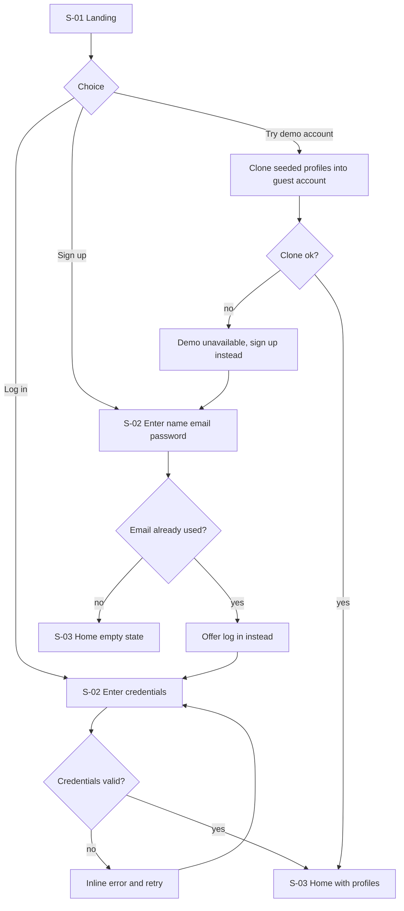

### Flow UC-02: Create a Business or Idea Card
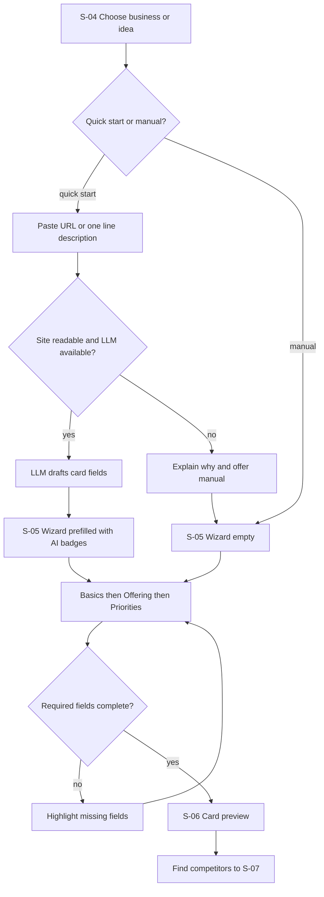

### Flow UC-03: Discover, review and confirm competitors
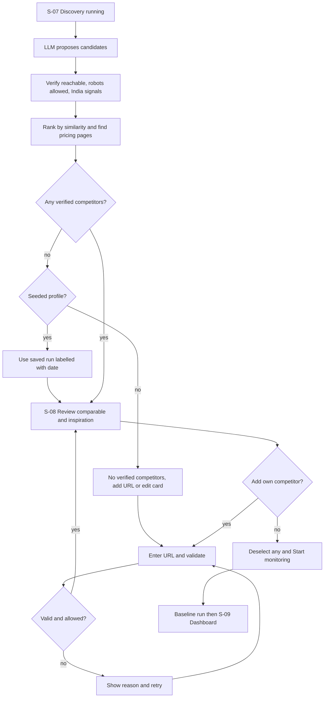

### Flow UC-04: Run monitoring and noise ledger
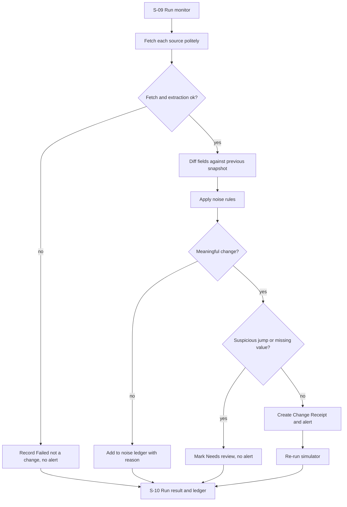

### Flow UC-05: Inspect a Change Receipt
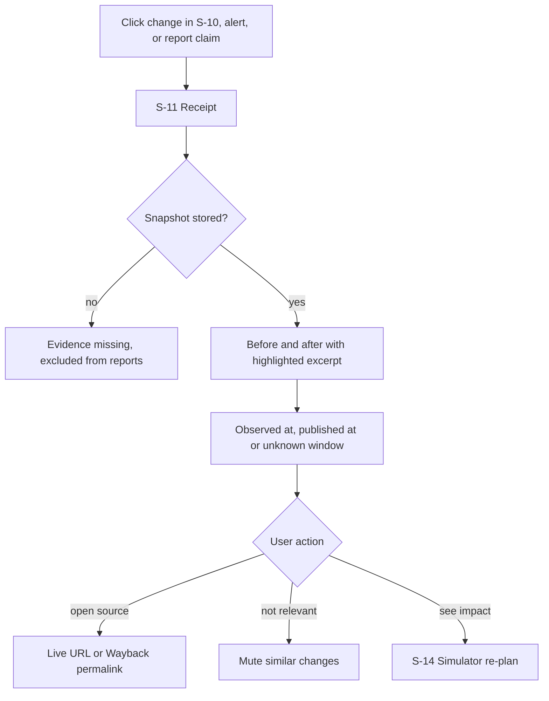

### Flow UC-06: Compare on configurable criteria
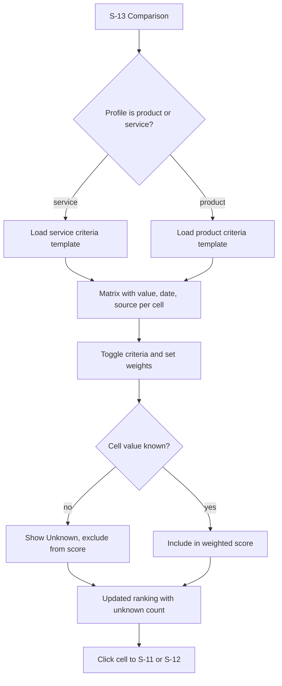

### Flow UC-07: Launch simulator and re-plan
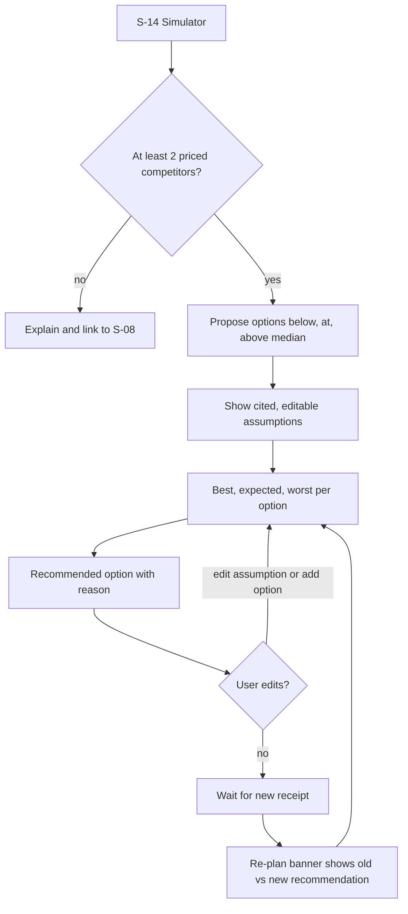

### Flow UC-08: Alerts
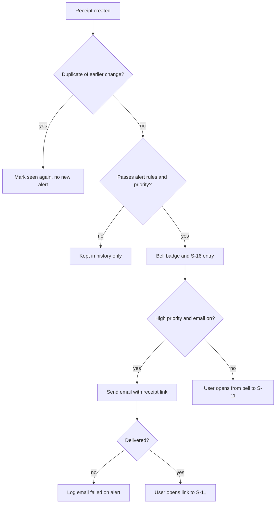

### Flow UC-09: Evidence report
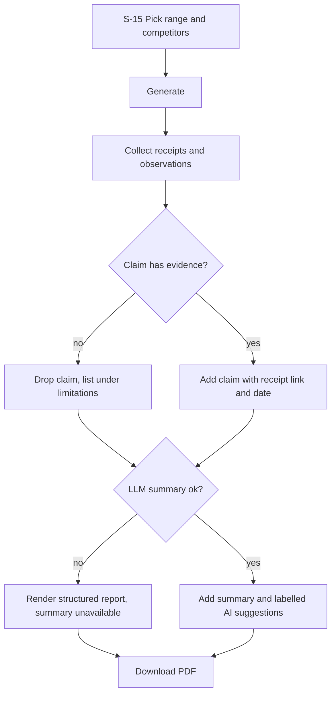

### Flow UC-10: Demo Lab
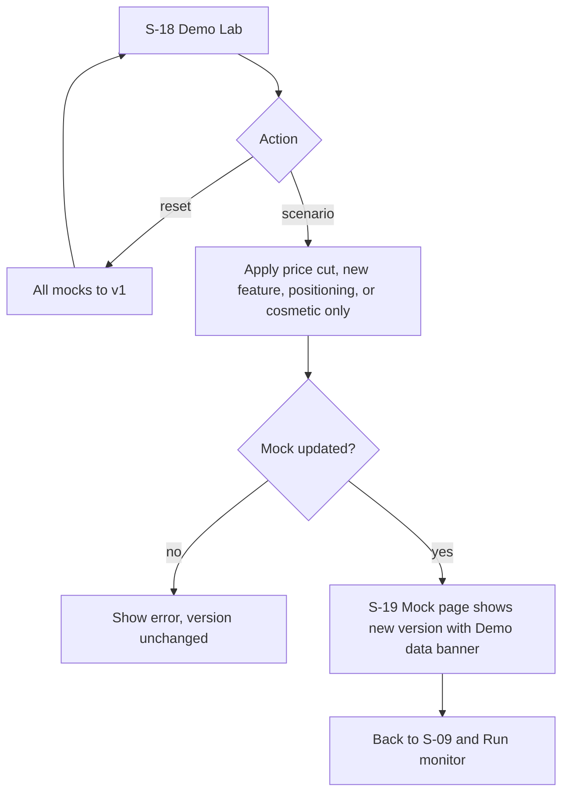

### Flow UC-11: Competitor history
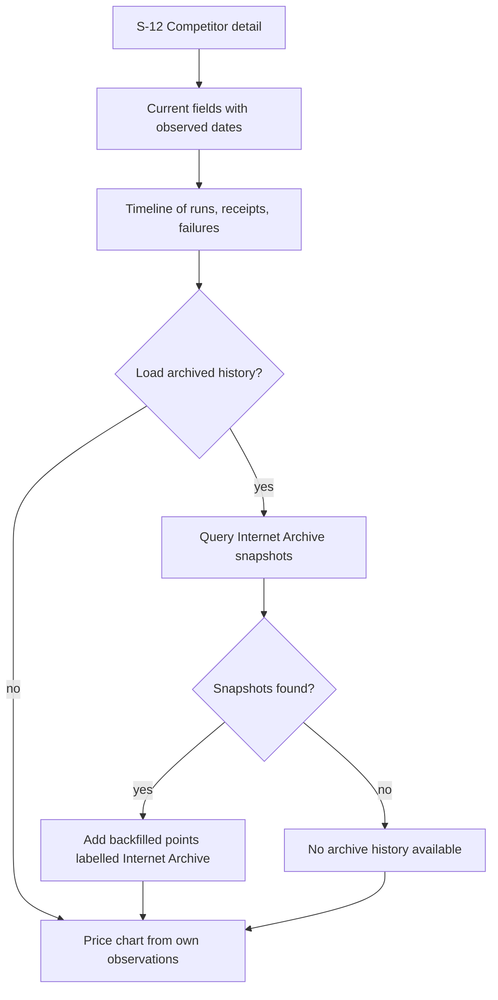

### Flow UC-12: Alert rules and sources
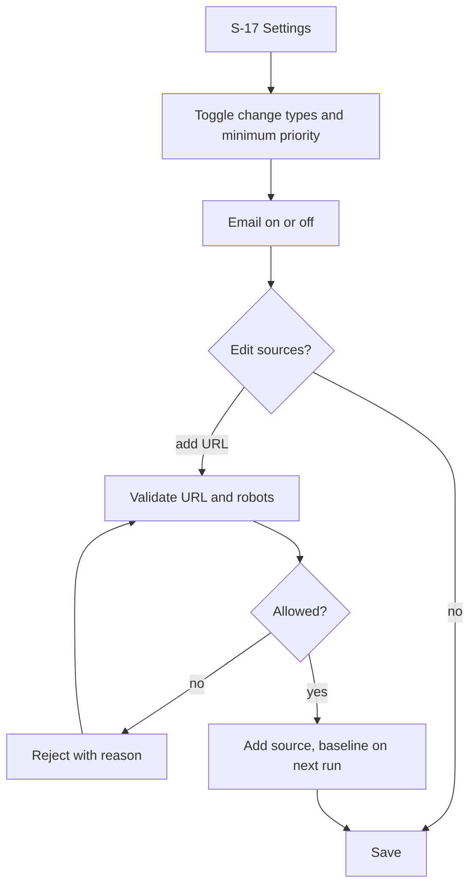

### Flow UC-13: Switch profiles
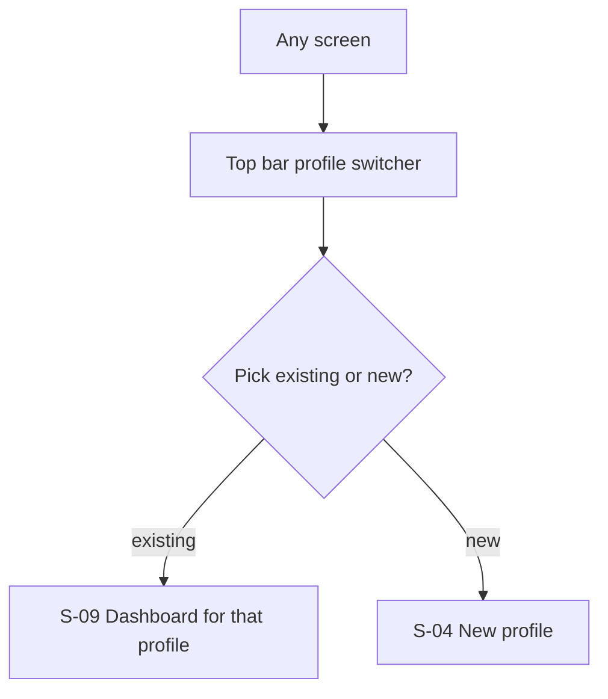

## 6. Screen inventory

Every screen after login shows the **top bar**: logo, profile switcher, **alert bell** (dropdown with top 5 alerts), Demo Lab link and account menu. It also shows the **left nav** for the selected profile: Dashboard, Competitors, Comparison, Simulator, Reports, Alerts, Settings.

### S-01: Landing
- **Purpose:** explain the value in 10 seconds and get people in.
- **Entry points:** public URL.
- **What's on it:** headline; a 3-step strip (describe your business → we find and watch competitors → proof plus re-plan); a static example of the noise ledger and a Change Receipt (labelled example); permitted-sources note.
- **Primary action:** Try demo account · **Secondary actions:** Sign up, Log in.
- **States:** success only (static).
- **Serves:** UC-01.

### S-02: Sign up / Log in
- **Purpose:** authenticate.
- **Entry points:** S-01.
- **What's on it:** tabs for Sign up (name, email, password) and Log in (email, password); a Try demo account button.
- **Primary action:** Create account / Log in · **Secondary actions:** Try demo account, switch tab.
- **States:** loading on submit / error inline (wrong password, email used, demo clone failed) / success redirects to S-03.
- **Serves:** UC-01.

### S-03: Home (profiles)
- **Purpose:** pick or create a business profile.
- **Entry points:** login, logo click, profile switcher "All profiles".
- **What's on it:** profile cards (name, Business or Idea badge, product or service, competitors monitored, unread alerts, last run, demo-data badge on seeded ones); + New profile.
- **Primary action:** Open profile · **Secondary actions:** + New profile, delete profile.
- **States:** empty ("Create your first profile" plus the demo hint) / success.
- **Serves:** UC-13, UC-01.

### S-04: New profile – path and quick start
- **Purpose:** choose the business or idea path and get an AI draft.
- **Entry points:** S-03, profile switcher.
- **What's on it:** two path cards; a URL field or a one-line description box; examples; a Fill manually link.
- **Primary action:** Draft my card · **Secondary actions:** Fill manually, Back.
- **States:** loading ("Reading your site…") / error (site unreadable, LLM unavailable, with fallback text) / success leads to S-05.
- **Serves:** UC-02.

### S-05: Profile wizard (Basics → Offering → Priorities)
- **Purpose:** confirm and complete the card.
- **Entry points:** S-04, Edit card on S-06 or S-09.
- **What's on it:** step indicator.
  - **Basics:** name, website, industry, India market and cities.
  - **Offering:** product vs service, category, key attributes, price, currency, billing period; the idea path instead asks for problem, target customer, planned features and a price range.
  - **Priorities:** change types to watch, criteria that matter.
  - AI-drafted fields carry a badge.
- **Primary action:** Next / Finish · **Secondary actions:** Back, Save draft.
- **States:** validation errors per field / success leads to S-06.
- **Serves:** UC-02.

### S-06: Card preview
- **Purpose:** show the Business or Idea Card that drives discovery and comparison.
- **Entry points:** S-05; Profile card link on S-09.
- **What's on it:** the card with fields grouped and labelled by origin (*You entered* / *AI-drafted* / *Public source*); "unknown" for missing values.
- **Primary action:** Find competitors · **Secondary actions:** Edit card.
- **States:** success.
- **Serves:** UC-02, UC-03.

### S-07: Discovery in progress
- **Purpose:** make automated discovery transparent.
- **Entry points:** S-06; Re-run discovery on S-08.
- **What's on it:** a live step list with counts (candidates proposed → reachable → robots-allowed → India-verified → ranked); a streaming log of candidates with pass or fail reasons.
- **Primary action:** none (auto-advances) · **Secondary actions:** Cancel.
- **States:** loading / error (LLM or search failure with fallback note, rate limit for guests) / success leads to S-08.
- **Serves:** UC-03.

### S-08: Discovered competitors review
- **Purpose:** confirm who to monitor.
- **Entry points:** S-07; Competitors nav.
- **What's on it:** tabs for Comparable and Inspiration. Each competitor row shows a checkbox, name, origin (AI-suggested / Added by you / saved run with date), India signals, similarity score, pages to watch (pricing, features, changelog), "not monitorable" for robots-blocked sites, and evidence links. There's an Add competitor URL field.
- **Primary action:** Start monitoring · **Secondary actions:** Add competitor URL, Re-run discovery, open S-12.
- **States:** empty ("No verified competitors yet") / loading while validating an added URL / error (invalid or blocked URL) / success.
- **Serves:** UC-03, UC-11.

### S-09: Profile dashboard
- **Purpose:** the profile's home with the latest picture.
- **Entry points:** S-03, profile switcher, after baseline, Dashboard nav.
- **What's on it:**
  - stats: competitors monitored, meaningful changes in the last 7 days, last run, failed sources
  - **Run monitor** button with per-source progress
  - recent receipts
  - simulator summary (recommended option, with a re-planned banner if one applies)
  - comparison snapshot (top 3 rows)
  - viability flags panel on Idea profiles
- **Primary action:** Run monitor · **Secondary actions:** open receipt, Comparison, Simulator, Generate report.
- **States:** empty (no sources: go to S-08) / loading (run in progress) / error (run failed, retry) / success.
- **Serves:** UC-04, UC-07, UC-13, UC-14.

### S-10: Monitoring run result & noise ledger
- **Purpose:** show what changed vs what was ignored, and why.
- **Entry points:** end of a run on S-09; Run history list on S-12.
- **What's on it:** a headline ("17 page diffs · 15 ignored · 2 meaningful"); meaningful changes (type, competitor, previous → current, priority) linking to S-11; Needs review items; Failed sources (not a change); the noise ledger table (diff, location, reason).
- **Primary action:** Open receipt · **Secondary actions:** Retry failed source, mark ledger item as "should have alerted" (feeds rules).
- **States:** "Nothing new since <time>" / success.
- **Serves:** UC-04.

### S-11: Change Receipt
- **Purpose:** prove one change.
- **Entry points:** S-10, the alert bell, S-16, report claims on S-15, timeline on S-12, cells on S-13, email link.
- **What's on it:**
  - change type, competitor, field, previous and current value, Δ%, priority with its score breakdown
  - observed-at, plus published-at or "happened between X and Y"
  - before and after snapshot viewer with the excerpt highlighted
  - source URL, Wayback permalink where available, snapshot hash
  - simulator impact line
- **Primary action:** View snapshot evidence · **Secondary actions:** Open source, Not relevant, See simulator impact.
- **States:** error ("evidence missing") / success; mobile-readable.
- **Serves:** UC-05, UC-08.

### S-12: Competitor detail & history
- **Purpose:** one competitor over time.
- **Entry points:** S-08, S-09, S-13, S-11.
- **What's on it:** profile (comparable or inspiration, India signals, monitored pages); current extracted fields with observed dates; price history chart; timeline of runs, receipts and failures; Load archived history (Should); review themes (seeded, labelled, Later).
- **Primary action:** Open receipt from timeline · **Secondary actions:** Load archived history, Stop monitoring.
- **States:** empty (baseline only) / loading archive / error (no archive history) / success.
- **Serves:** UC-11, UC-05.

### S-13: Comparison matrix
- **Purpose:** a sourced side-by-side on configurable criteria.
- **Entry points:** Comparison nav, S-09.
- **What's on it:** a Comparable / Inspiration switch; the criteria template name (product or service); a criteria list with toggles and weight sliders; the matrix (your product plus competitors) with value, observed date and source icon per cell; **Unknown** cells; weighted score with an unknown-count note.
- **Primary action:** Adjust weights · **Secondary actions:** click a cell to open S-11 or S-12, reset criteria.
- **States:** empty (no baseline) / success.
- **Serves:** UC-06.

### S-14: Launch simulator
- **Purpose:** compare launch options using evidence and stated assumptions.
- **Entry points:** Simulator nav, S-09, S-11.
- **What's on it:**
  - the re-planned banner, when present
  - option cards A, B and C (plus "your option"): price, feature set, best, expected and worst metrics, cited competitor data
  - the assumptions panel (editable; each tagged *from evidence* with a receipt link, or *your assumption*)
  - the recommended option with its reason
  - on Idea profiles, viability risk flags with citations
  - the "Scenario model, not a forecast" label
- **Primary action:** Edit assumptions · **Secondary actions:** Add my own option, Reset, open the cited receipt.
- **States:** empty ("Need at least 2 priced competitors") / success.
- **Serves:** UC-07, UC-14.

### S-15: Evidence report
- **Purpose:** a concise report for sharing.
- **Entry points:** Reports nav, S-09.
- **What's on it:** date range and competitor pickers; a Generate button; the report preview (summary, comparison, changes over time, simulator implications, AI suggestions block, data limitations); every fact carries an inline citation (receipt link and date).
- **Primary action:** Download PDF · **Secondary actions:** Regenerate, open a cited receipt.
- **States:** loading / error (summary unavailable, structured-only report) / success.
- **Serves:** UC-09.

### S-16: Alert center
- **Purpose:** all alerts, filterable.
- **Entry points:** the bell's View all, the Alerts nav.
- **What's on it:** alert rows (priority, one-line explanation, previous → current, observed date, profile, read state, "seen again" count, email delivery status); filters for profile, priority, type and unread.
- **Primary action:** Open receipt · **Secondary actions:** Mark read, Mute competitor or type.
- **States:** empty ("No alerts, all quiet") / success.
- **Serves:** UC-08.

### S-17: Alert & source settings
- **Purpose:** tune alerts and monitored pages.
- **Entry points:** Settings nav, the Mute action on S-16.
- **What's on it:** change-type toggles; a minimum priority control; the email on/off toggle with the address; monitored sources per competitor with add and remove.
- **Primary action:** Save · **Secondary actions:** Add source.
- **States:** validation error (blocked or invalid URL) / success toast.
- **Serves:** UC-12.

### S-18: Demo Lab
- **Purpose:** trigger labelled simulated changes.
- **Entry points:** top-bar Demo Lab link.
- **What's on it:** a banner ("Simulated data for demonstration, fictional companies"); mock competitor list (NimbusDeploy (demo) and others) with current version; scenario buttons (Cut Pro price 40%, Add feature, Change positioning headline, Cosmetic-only change); View mock page; Reset all.
- **Primary action:** Apply scenario · **Secondary actions:** View mock page, Reset all.
- **States:** error (update failed) / success toast ("v2 live, now Run monitor").
- **Serves:** UC-10.

### S-19: Mock competitor page (public)
- **Purpose:** the monitored fake pricing page.
- **Entry points:** S-18 View mock page; the monitoring fetcher.
- **What's on it:** a realistic pricing page (plans, ₹ prices, feature list, nav, footer, promo banner) with a permanent "Demo data, fictional company" ribbon.
- **Primary action:** none · **Secondary actions:** none.
- **States:** v1 / v2 / cosmetic variant.
- **Serves:** UC-10, UC-04.

## 7. Navigation map

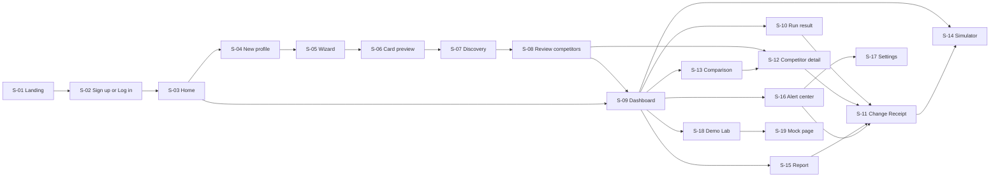

*Global from any logged-in screen: top bar to S-03 (switcher), S-16 (bell), S-18 (Demo Lab); left nav to S-08, S-09, S-13, S-14, S-15, S-16, S-17.*

## 8. Coverage matrix

| Feature (from scope) | Use cases | Screens | Priority |
|---|---|---|---|
| Sign-up / login + demo account | UC-01 | S-01, S-02 | MVP |
| Business / Idea Card (quick start + wizard) | UC-02 | S-04, S-05, S-06 | MVP |
| Automated competitor discovery (India) + add own | UC-03 | S-07, S-08 | MVP |
| Collector + snapshot store | UC-04 | S-09, S-10 | MVP |
| Structured extraction | UC-04, UC-11 | S-10, S-12 | MVP |
| Change detection + noise ledger | UC-04 | S-10 | MVP |
| Change Receipts + history (observed vs published) | UC-05, UC-11 | S-11, S-12 | MVP |
| Comparison matrix (product/service criteria, weights, unknowns) | UC-06 | S-13 | MVP |
| Evidence report + PDF | UC-09 | S-15 | MVP |
| Alerts: bell, center, priority, dedupe | UC-08 | top bar, S-16 | MVP |
| Alert rules + sources config | UC-12 | S-17 | MVP (thin) |
| Email alert | UC-08 | S-16, S-17 | Should |
| Launch simulator + auto re-plan | UC-07 | S-14, S-09, S-11 | MVP |
| Demo Lab + mock pages | UC-10 | S-18, S-19 | MVP |
| Multi-profile switching | UC-13 | S-03, top bar | MVP |
| Viability risk flags (idea profiles) | UC-14 | S-14, S-09 | Should |
| Wayback history backfill | UC-11 | S-12 | Should |
| Review themes | UC-15 | S-12 | Later (seeded) |
| Inspiration companies | UC-03, UC-06 | S-08, S-13 | MVP as a tab; feature-gap suggestions Could |

## 9. Demo golden path

Total about 4 minutes. The seeded profiles exist, and the mocks are reset to v1 beforehand.

| Step | Screen | What happens | What to say |
|------|--------|--------------|-------------|
| 1 | S-01 → S-02 → S-03 | Click Try demo account; Home shows the seeded profiles | "Founders in India check rivals' pricing pages by hand, and generic tools drown them in false alerts." |
| 2 | S-04 → S-05 → S-06 | New profile → "Pune startup, managed app deployment for Indian developers, Pro ₹999/mo" → Draft my card → quick check → card | "One line in. The AI drafts the card, and every AI-drafted field is labelled." |
| 3 | S-07 → S-08 | Live discovery with checks; review comparable vs inspiration; **Add competitor URL** for the mock *NimbusDeploy (demo)*; Start monitoring | "It found competitors serving India and checked robots.txt and India signals. I add one more myself." |
| 4 | S-09 → S-13 → S-14 | Baseline: matrix with unknowns, simulator recommends ₹999 | "Every cell has a date and a source. Unknowns don't count against anyone." |
| 5 | S-18 → S-09 → S-10 | Demo Lab: Cosmetic-only change, then run → "6 diffs, all ignored". Then Cut Pro price 40% + add feature, run → "17 diffs · 15 ignored · 2 meaningful" | "First, a pure redesign: zero alerts. Now a real price cut." |
| 6 | Bell → S-11 | A high-priority alert opens the receipt: ₹1,499 → ₹899, observed-at, before and after with highlight | "This is the proof: the saved page with the exact line, not a link to a page that's already changed." |
| 7 | S-14 → S-15 | Re-planned banner: ₹999 → ₹849 with cited assumptions; generate the report and Download PDF; show the email on a phone | "The change flows straight into your launch decision, and every claim in the report links back to a receipt." |
| 8 | Switcher → quantum profile S-14 | Viability flags: "no scenario breaks even within 36 months under these assumptions" | "Same engine for an idea: evidence-backed risk flags, not predictions." |

## 10. Assumptions & open questions

- **Assumed:**
  - Try demo account clones the seeded profiles into a fresh guest account.
  - Home is the profile list.
  - Criteria are edited inline on S-13; alert rules live on S-17.
  - Monitoring runs on a button.
  - Desktop-first, with S-11 readable on a phone.
- **Time cost of decisions:**
  - **Real auth** adds about 45 minutes to a Must tier that already fills the remaining time. Use a managed auth service to keep it short.
  - **Email** and **PDF** are Should and S respectively. PDF can use browser print styles on S-15.
- **Still open:**
  - The official submission time.
  - Whether guest accounts get live discovery or the seeded profiles only, if the free LLM's limits turn out tight in testing. The current default is live with a rate limit.
  - Which real company pages are safe to monitor live (robots.txt check pending).
  - The final product name (RivalLens is a placeholder).
